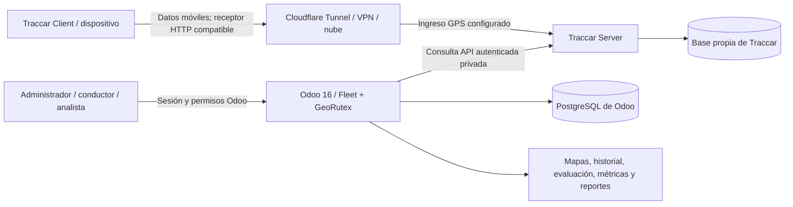

# GeoRutex — Arquitectura técnica y contratos de implementación

**Producto:** GeoRutex — Sistema de Monitoreo y Evaluación de Rutas  
**Repositorio:** `georutex`  
**Addon técnico de Odoo:** `uta_transport_monitor`  
**Decisión:** arquitectura modular por capas adaptada a Odoo 16 Community; lógica determinista aislada e integración Traccar mediante un adaptador.  
**Requisitos y rúbrica de referencia:** [`requirements.md`](requirements.md), especialmente secciones 0, 3–8 y 11–16.

> **Alcance de este documento:** establece responsabilidades, dependencias y estrategia de verificación. No redefine los mínimos académicos, las fórmulas ni las tolerancias que se encuentran en `requirements.md`. Las configuraciones propuestas son decisiones `[DISEÑO]`, no afirmaciones sobre lo exigido oralmente por el docente.

## 1. Decisión arquitectónica y alternativas

La base es **Odoo 16 Community + Fleet**, con su ORM, herencia mediante `_inherit`, ACL, reglas por registro, acciones, vistas XML, recursos Owl y trabajos `ir.cron`. Traccar Server/Client proporciona la captura de GPS, almacenamiento original y API. Se evita reproducir el núcleo de cualquiera de estas plataformas.

| Alternativa | Evaluación | Decisión |
|---|---|---|
| Onion/Clean estricta | Exigiría entidades paralelas y repositorios artificiales sobre el ORM de Odoo | No imponerla mecánicamente |
| CRUD sin separación de dominio | Mezcla consultas GPS, cálculos y presentación; complica reproducibilidad | Descartada |
| Microservicios personalizados adicionales | Aumentan despliegue, contratos y pruebas sin beneficio necesario | No introducirlos por defecto |
| **Odoo modular por capas + adaptador Traccar** | Facilita reutilización, pruebas de reglas y trazabilidad sin contrariar al framework | **Adoptada** |

El diseño aplica **separación de responsabilidades**, no una regla rígida de que el dominio deba encapsular todas las entidades del ORM. El cálculo matemático sí puede desacoplarse y recibir estructuras ordinarias para probarlo de forma determinista.

## 2. Vista de contexto y flujo de información



**Flujo de negocio:** Traccar recibe una posición con identificador de dispositivo y marcas temporales; un proceso de Odoo recupera posiciones desde una ventana incremental, valida calidad/duplicados, asocia cada punto a un vehículo y a una instancia programada cuando corresponda, aplica reglas de ruta/paradas y registra incidencias y resultados. Los reportes se construyen con datos verificables guardados o consultados legítimamente desde Odoo.

**Separación de red:** el receptor GPS suele usar OsmAnd sobre HTTP (puerto habitual 5055); la interfaz/API administrativa de Traccar suele usar 8082; Odoo suele usar 8069. Estos valores son **referencias**, no suposiciones válidas sin verificar la versión y configuración. No publicar 8082 como solución improvisada para ingestión. Traccar Client debe poder enviar a través de la red celular; Cloudflare Tunnel HTTP no implica soporte automático de cualquier protocolo TCP/UDP.

## 3. Componentes, carpetas y dependencias

La estructura completa del repositorio se mantiene **únicamente** en `requirements.md`, sección 12.3. Para el addon, la distribución de responsabilidades es:

| Carpeta | Contenido y ejemplos | Dependencias permitidas |
|---|---|---|
| `models/` | `fleet.vehicle` heredado, `transport.route`, versiones, controles, viajes, posiciones, evaluaciones, incidencias, restricciones | Odoo ORM; invocación de servicios cuando procede |
| `services/` | `gps_sync.py`, `trip_service.py`, orquestación, transacciones, disparadores y asignaciones | `models/`, `domain/`, `integrations/` según caso |
| `domain/` | `geo.py`, `evaluation.py`, `metrics.py`; funciones puras sobre coordenadas, tiempos, reglas y KPI | Biblioteca estándar Python y tipos/objetos de datos sencillos; **sin** Odoo, HTTP, SQL ni UI |
| `integrations/` | `traccar_client.py`; autenticación, consulta, normalización, timeout, backoff y excepciones tipadas | Cliente HTTP comprobado; **sin** ORM ni lógica de evaluación |
| `security/` | Grupos, `ir.model.access.csv`, reglas por registro | Modelo de seguridad Odoo |
| `views/`, `static/src/` | Formularios, menús, mapa, dashboard y recursos JS/Owl compatibles con Odoo 16 | API segura de Odoo; no tokens Traccar en navegador |
| `data/` | Cron, datos declarativos y valores configurables | Odoo XML/CSV; sin contraseñas |
| `demo/` | Datos demostrativos **identificados como tales**, si el contexto los requiere | No equivalen a 10 recorridos efectivamente ejecutados |
| `i18n/es.po` | Traducciones a español desde textos fuente en inglés | Convenciones de localización Odoo 16 |
| `static/description/` | Descripción e icono del módulo, respetando licencias | Archivos estáticos del addon |
| `tests/` | Pruebas nativas Odoo de modelos, seguridad, integración controlada | Ejecutor Odoo 16 y `TransactionCase`/otras herramientas compatibles |

La convención es **una sola**: `integrations/traccar_client.py` contiene el cliente externo; `domain/geo.py`, `domain/evaluation.py` y `domain/metrics.py` contienen las reglas puras. Nunca crear copias equivalentes en `services/` para resolver la contradicción de ubicaciones.

No trasladar automáticamente a Python puro cualquier fórmula que necesite contexto ORM: `domain/` calcula; `services/` obtiene datos, aplica filtros/permisos, coordina estados y persiste los resultados. Evitar cálculos duplicados en modelos, frontend y reportes.

## 4. Estrategia de reutilización e integración

1. **Reutilización base:** usar Fleet para registrar vehículos y Traccar para recibir/consultar posiciones y trayectos; adaptar su funcionalidad únicamente donde los requisitos lo exijan.
2. **Conector candidato:** verificar licencia, distribución, compatibilidad real con **Odoo 16 Community**, modelos, vistas, API y autenticación contra el Traccar desplegado. Un módulo para Odoo 19 no se considera válido por cambiar `__manifest__.py`.
3. **Puerta de aceptación:** comprobar dispositivo vinculado, datos móviles → servidor → API autenticada → Odoo, posición reciente con hora, historial y mapa, y resincronización sin duplicados. Conservar evidencia de la ejecución efectiva.
4. **Alternativa segura:** si la reutilización no resulta compatible o legalmente viable, implementar un adaptador HTTP propio en `integrations/traccar_client.py` con interfaz de consulta mínima. La orquestación de sincronización sigue en `services/gps_sync.py`.
5. **Propiedad del proyecto:** programación de rutas, puntos, versiones, evaluación de cumplimiento, incidencias manuales/automáticas, métricas, dashboard, pruebas e informe de mejora continua son responsabilidad del módulo propio; un iframe no los reemplaza.

### 4.1. Sincronización y datos

- Odoo guarda vínculo inequívoco `fleet.vehicle` ↔ `deviceId` Traccar; `uniqueId` del dispositivo es un atributo diferente.
- Consultar ventanas de tiempo en UTC con solapamiento seguro; usar claves estables y restricciones de unicidad para deduplicación; procesar entradas fuera de orden sin retroceder la última posición válida.
- Registrar puntos rechazados y causas (formato inválido, velocidad físicamente improbable, señal obsoleta); no asignar un punto a varios viajes incompatibles.
- Conservar origen `real` o `simulado`, versión de la ruta y snapshot de tolerancias y parámetros utilizados en cada evaluación; cuando falta evidencia, usar **indeterminado**.
- Las fórmulas y denominadores oficiales no se redefinen aquí: ver `requirements.md`, sección 8. Las tolerancias configurables están en sección 7.
- Persistir información suficiente en Odoo para historial y trazabilidad; no realizar escritura directa a la base interna de Traccar.

## 5. Contrato de pruebas y ejecución

La matriz de casos, umbrales, resultados esperados y requisitos de aceptación están en [`requirements.md`, sección 11](requirements.md#11-plan-de-pruebas-de-aceptación-y-verificación). Aquí se establecen únicamente ubicaciones y procedimientos técnicos.

| Suite | Ruta | Entorno / descubrimiento |
|---|---|---|
| Humo de importación | `tests/unit/test_domain_import.py` | Pytest en servicio de prueba **con Odoo 16 instalado** y `addons_path` registrado; probar `from odoo.addons.uta_transport_monitor.domain import geo` |
| Dominio puro | `tests/unit/test_*.py` | Pytest/pytest-cov en ese entorno, sin Traccar ni base operativa; funciones `domain/` sin dependencias de ORM/HTTP |
| Odoo nativo ORM/ACL | `addons/uta_transport_monitor/tests/test_*.py` | Runner Odoo 16 con base PostgreSQL de prueba **descartable**, addon instalado y `tests/__init__.py` importando explícitamente cada archivo de prueba |
| Integración | `tests/integration/` | Stack Odoo/Traccar aislado, datos y credenciales de prueba; nunca sustituye prueba GPS celular |
| Rendimiento | `tests/performance/` | Stack estable, muestras frías/calientes por separado y entorno documentado |
| GPS externo | `evidence/gps_external/` | Teléfono real, Wi-Fi desactivada, datos móviles y receptor alcanzable; evidencia humana |

**Importación y registro:** ejecutar la suite desde un contenedor basado en Odoo 16 Community. Montar `./addons` en el directorio de addons personalizado de la imagen y añadirlo a `addons_path` junto con addons oficiales (por ejemplo, `/mnt/extra-addons` en la imagen oficial si la configuración real lo confirma); la mera presencia de Odoo en el sistema Python **no garantiza** descubrimiento automático del addon. No añadir `addons/` al `PYTHONPATH` como un paquete Odoo de nivel superior ni manipular `sys.modules`. El primer test de humo importa mediante `odoo.addons.uta_transport_monitor`, y debe ejecutarse **antes** de aprobar la infraestructura de pruebas. La implementación de `__init__.py` debe respetar el mecanismo normal de registro y carga del addon; una importación exitosa no prueba instalación del módulo ni modelos ORM cargados.

**Infraestructura:** mantener `infra/odoo/Dockerfile` con base Odoo **16** y dependencias de `requirements-dev.txt` instaladas en la imagen de prueba, según permisos de usuario Python de la imagen; el servicio o perfil `test` de `compose.yaml` debe seleccionar esa imagen, base de prueba aparte, volumen del addon, comandos de prueba y posibilidad de obtener `coverage.xml`. No instalar herramientas de desarrollo innecesarias en la imagen operativa. El `pytest.ini` debe definir la ruta de descubrimiento de tests propios, `testpaths = tests/unit`, con ejecución explícita para integración/rendimiento; evitar nombres ambiguos y reconfiguración manual de `sys.path`.

**Comandos de referencia sujetos a verificación en la Fase 0:**

```bash
# En el servicio de pruebas que incorpora Odoo 16 y addons_path:
python -m pytest -c pytest.ini tests/unit --cov=odoo.addons.uta_transport_monitor.domain --cov-report=xml:coverage.xml

# Pruebas nativas: instalar/actualizar el addon en base temporal y ejecutar con el runner Odoo 16;
# adaptar servicio/host/DB a la configuración real antes de tomar esta línea como comando operativo:
odoo --database georutex_test --init uta_transport_monitor --test-enable --stop-after-init --db_host=postgres_test --addons-path=/usr/lib/python3/dist-packages/odoo/addons,/mnt/extra-addons
```

**CI y calidad:** ejecutar humo/importaciones, pruebas unitarias, pruebas Odoo con PostgreSQL temporal, contratos de integración que no necesiten celular y análisis SonarQube **cuando el servidor/tokens estén disponibles**. `sonar-project.properties` analiza código propio, excluye vendor/fixtures/evidencias y consume cobertura realmente instrumentada; la cobertura de Pytest no representa las pruebas nativas si estas no se midieron. Cobertura y Quality Gate exigibles se establecen solo en `requirements.md`, secciones 4 y 11. Pruebas móviles, infraestructura expuesta y métricas de desempeño físico requieren pruebas y aprobación humana.

## 6. Despliegue, seguridad y archivos operacionales

- **Preferencia:** Docker Compose con Odoo 16 Community, PostgreSQL persistente, Traccar persistente y conectividad externa configurada. Una VM o VPS es alternativa permitida. La reunión no confirma de manera inteligible una obligación o prohibición de Docker.
- Infraestructura sugerida en `infra/odoo/` (configuración), `infra/traccar/` (configuración y persistencia), `infra/cloudflare/` (túnel cuando se adopte); scripts de arranque, diagnóstico y backup/restauración en `scripts/`. No incluir secretos reales ni respaldos privados en Git.
- Crear `.gitignore`, `.env.example`, `sonar-project.properties`, `pytest.ini`, `requirements-dev.txt` y CI al implementar sus funciones. `sonar-project.properties` escanea el **código propio**, excluye `static/lib` y otras bibliotecas vendorizadas, artefactos generados, evidencia privada y fixtures que no sean código productivo; no ocultar problemas del código propio mediante exclusiones arbitrarias.
- CI progresiva: validaciones y unitarias, luego pruebas Odoo/PostgreSQL; escaneo SonarQube solamente si la configuración y secretos necesarios están disponibles. Una CI exitosa no demuestra conectividad desde datos móviles ni recorridos físicos.
- Para Traccar Client/OsmAnd, un `uniqueId` no ofrece por sí solo autenticación criptográfica del origen. Aplicar HTTPS y acceso mínimo, IDs no predecibles, limitación de solicitudes/observabilidad cuando sea viable, configuración de registro público restringida y separación de redes. La interfaz/API administrativa de Traccar debe permanecer interna o bajo protección explícita.
- Los datos reales de localización son privados; `evidence/` permanece ignorada por Git salvo el índice saneado `evidence/INDEX.md`, con ID, fecha, estado y canal privado de entrega. Versionar exclusivamente evidencias saneadas y autorizadas. Archivos de origen en `docs/fuentes/` también deben contar con autorización para ser publicados.
- El sistema presenta resultados en español mediante traducciones Odoo (`i18n/es.po`); código/identificadores en inglés; respetar licencias y atribuciones de dependencias y cartografía.

## 7. Puertas de aprobación humana y control de calidad

La ejecución de las pruebas y la creación de archivos de configuración son automatizables, pero **no equivalen a evidencia real** de los siguientes requisitos:

| Validación | Condición de aprobación | Si no puede ejecutarse |
|---|---|---|
| Datos móviles y túnel/VPN | Posiciones recibidas desde teléfono con Wi-Fi apagado y demostradas en Traccar/Odoo | `PENDIENTE DE VALIDACIÓN EXTERNA`; indicar configuración/acción necesaria |
| Compatibilidad de conector | Instalación y sincronización reales sobre Odoo 16 | Registrar candidato como **no validado**; utilizar adaptador propio si procede |
| Diez recorridos documentados | Escenarios **ejecutados** con resultado obtenido, trazabilidad y marca real/simulado | No contarlos a partir de fixtures sin ejecutar |
| SonarQube | Informe real de ejecución de scanner/servidor | Declarar bloqueo, sin fabricar hallazgos |
| Rendimiento | Métricas medidas con volumen, ambiente y herramienta registrados | Declarar no medido; no fijar valores estimados como resultados |
| Ishikawa/PDCA | Defecto realmente observado, corrección implementada, antes/después verificado | No inventar mejora ni cerrar la fase |

Aplicar controles de acceso por roles en backend, validación de datos GPS y geográficos, límites de sincronización, redacción de evidencia personal y protección de secretos. Documentar pruebas y decisiones en los entregables definidos en `requirements.md`, sección 12.3; asociar cada resultado a los requisitos y criterios de la rúbrica (secciones 11, 14, 15).

## 8. Referencias técnicas

- Odoo 16, desarrollo: https://www.odoo.com/documentation/16.0/developer.html
- Odoo 16, pruebas: https://www.odoo.com/documentation/16.0/developer/reference/backend/testing.html
- Traccar, API: https://www.traccar.org/traccar-api/
- Traccar, receptor OsmAnd: https://www.traccar.org/osmand/
- Cloudflare Tunnel: https://developers.cloudflare.com/cloudflare-one/networks/connectors/cloudflare-tunnel/
