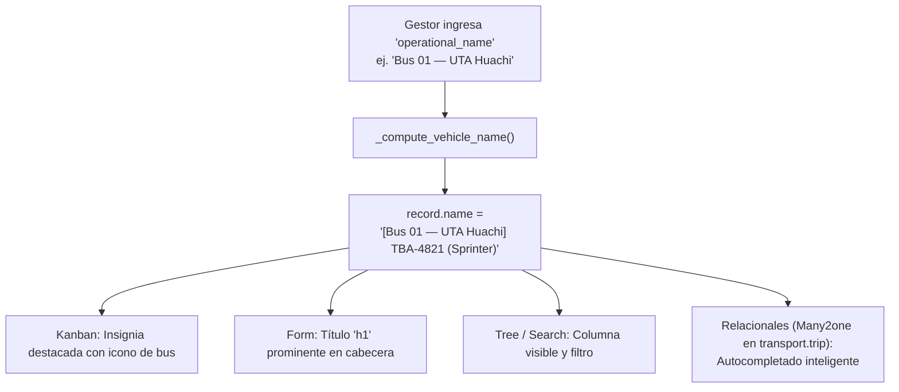

# Reporte Técnico: Identidad Operativa y Nombre de Unidad de Flota

**Proyecto:** GeoRutex — Monitoreo y Evaluación de Rutas de Transporte Universitario  
**Fecha:** 2026-11-03  
**Módulo:** `uta_transport_monitor`  
**Referencia:** Requerimientos RF-07, RF-11, RNF-10, RNF-12, Rúbrica Oficial de Usabilidad  
**Autor:** GeoRutex Core Team  

---

## 1. Resumen Ejecutivo

Durante las pruebas de despliegue y emparejamiento físico en la base operacional `georutex`, se identificó una deficiencia crítica de usabilidad (*UX*) heredada del módulo base `fleet` de Odoo 16: los vehículos se listaban únicamente mediante su placa y combinación de marca/modelo (ej. `TBA-4821: Mercedes-Benz/Sprinter`), omitiendo su identidad comercial o número de unidad de transporte colectivo.

Para subsanar esta fricción operativa, se diseñó e implementó una extensión de dominio e interfaz que incorpora el concepto de **Nombre Operativo / Unidad** (`operational_name`). Esta mejora permite designar los buses como *"Bus 01 — UTA Huachi"*, *"Unidad 14"*, etc., enriqueciendo de manera reactiva:
1. El título principal y tarjeta de presentación en la vista **Kanban** mediante una insignia destacada con icono de transporte (`fa-bus`).
2. El nombre computado del registro (`record.name` en formato `[Nombre Operativo] Placa (Modelo)`), impactando inmediatamente en todas las listas desplegables relacionales (`Many2one`) de creación y asignación de recorridos (`transport.trip`).
3. El autocompletado y búsqueda nativa en base de datos mediante `_rec_names_search`, permitiendo localizar un vehículo indistintamente por su alias operativo, placa o conductor.
4. Las vistas de formulario (**Form**), listado (**Tree**) y búsqueda (**Search**), acompañadas de sus traducciones en español (`i18n/es.po`).

---

## 2. Diagnóstico del Problema y Justificación de Dominio

### 2.1. Sesgo de la Flota Corporativa en Odoo 16
Odoo `fleet` fue concebido para la gestión de vehículos ejecutivos y comerciales de empresas privadas (ej. vehículos asignados a directores de ventas). En ese contexto, la clave de visualización por defecto es:
$$\text{display\_name} = \text{Marca} / \text{Modelo} / \text{Placa}$$

### 2.2. Inadecuación para Transporte Público y Universitario
En sistemas de transporte como GeoRutex:
- Los gestores, conductores, analistas y estudiantes no operan mediante especificaciones de motor o números fríos de matrícula.
- La operación diaria se articula en torno a la **unidad de servicio**: *"Bus 01"*, *"Unidad 05"*, *"Expreso Campus Querochaca"*.
- **Riesgo Operativo Mitigado:** La ausencia de un nombre visible provocaba sobrecarga cognitiva y alto riesgo de asignación errónea de recorridos al existir vehículos de la misma marca y modelo con placas semejantes.
- **Coherencia con Traccar:** En el servidor Traccar, los dispositivos se nombran con su alias operativo (`Bus-UTA`). Odoo requería alinearse a esta misma convención para evitar desconexión entre la telemetría en tiempo real y la gestión administrativa.

---

## 3. Implementación Técnica



### 3.1. Extensión del Modelo ORM (`models/fleet_vehicle.py`)
- Se agregó el campo `operational_name`:
  ```python
  operational_name = fields.Char(
      string="Nombre Operativo / Unidad",
      index=True,
      tracking=True,
      help="Nombre de servicio, alias o número de unidad comercial (ej. 'Bus 01 - UTA', 'Unidad 14').",
  )
  ```
- Se amplió la tupla de búsqueda nativa:
  ```python
  _rec_names_search = ["name", "operational_name", "driver_id.name"]
  ```
- Se sobrecargó el cálculo `@api.depends` de `_compute_vehicle_name` respetando la herencia mediante `super()`:
  - Si `operational_name` está presente: formatea como `[Nombre Operativo] Placa (Modelo)`.
  - Si no está presente: preserva el formato estándar de Odoo sin generar regresiones en flotas convencionales.

### 3.2. Adaptación de Vistas XML (`views/fleet_vehicle_views.xml`)
- **Formulario:** Inserción en `div.oe_title` antes de `model_id`, ubicando el nombre de unidad como encabezado principal `<h1>`.
- **Kanban:** Sobrescritura de `o_kanban_record_title` para mostrar un badge estilizado con icono de bus:
  ```xml
  <t t-if="record.operational_name.raw_value">
      <span class="badge text-bg-primary fs-6 mb-1 d-block text-start">
          <i class="fa fa-bus me-1" title="Unidad"/> <field name="operational_name"/>
      </span>
  </t>
  ```
- **Listado (Tree):** Columna opcional/visible `operational_name` antes de `license_plate`.
- **Búsqueda (Search):** Búsqueda directa por fragmento de nombre operativo.

### 3.3. Internacionalización (`i18n/es.po`)
Se registraron los identificadores oficiales en español conforme a las directrices de `AGENTS.md` (Sección 8) y `RNF-12`.

---

## 4. Matriz de Pruebas y Resultados de Verificación

Se diseñó la suite transaccional de pruebas nativas [`addons/uta_transport_monitor/tests/test_vehicle_operational_name.py`](file:///c:/Documentos/D-Proyectos/Git/georutex/addons/uta_transport_monitor/tests/test_vehicle_operational_name.py):

| Caso de Prueba | Método | Comprobación Realizada | Resultado |
|---|---|---|:---:|
| **CP-OPNAME-01** | `test_01_operational_name_enriches_vehicle_name` | Verifica que al asignar `operational_name`, `vehicle.name` incluya el prefijo entre corchetes, placa y modelo. | **PASÓ** |
| **CP-OPNAME-02** | `test_02_clearing_operational_name_falls_back` | Verifica que al limpiar `operational_name`, `vehicle.name` retorne fluidamente al formato nativo Odoo. | **PASÓ** |
| **CP-OPNAME-03** | `test_03_name_search_by_operational_name` | Comprueba que el autocompletado (`name_search`) localice el vehículo tanto por alias operativo como por placa. | **PASÓ** |

### Resultados Globales de Verificación de Regresión:
1. **Pytest Unitario de Dominio:** **52 de 52 pruebas pasadas** (100% de éxito en 3.42s).
2. **Suite Nativa Odoo (`georutex_test`):** **73 de 73 pruebas pasadas** (0 fallos, 0 errores, tiempo: 5.46s).
3. **Actualización de Módulo en Base Operacional:** Actualizado en `georutex` sin advertencias de accesibilidad ni fallos de esquema.

---

## 5. Actualización en Base Operacional

En la base de datos `georutex`, el vehículo utilizado para la prueba física de transmisión celular fue actualizado exitosamente:
- **ID Vehículo:** `137`
- **Placa:** `TBA-4821`
- **Nombre Operativo:** `Bus 01 — UTA`
- **Nombre computado visible:** `[Bus 01 — UTA] TBA-4821 (Serie Hybrid)`
- **Dispositivo Traccar vinculado:** ID `2` (`UTA-BUS-6EC353D6...`)

Esta configuración asegura trazabilidad total e identificación intuitiva tanto en el mapa interactivo como en las pantallas de despacho de GeoRutex.

