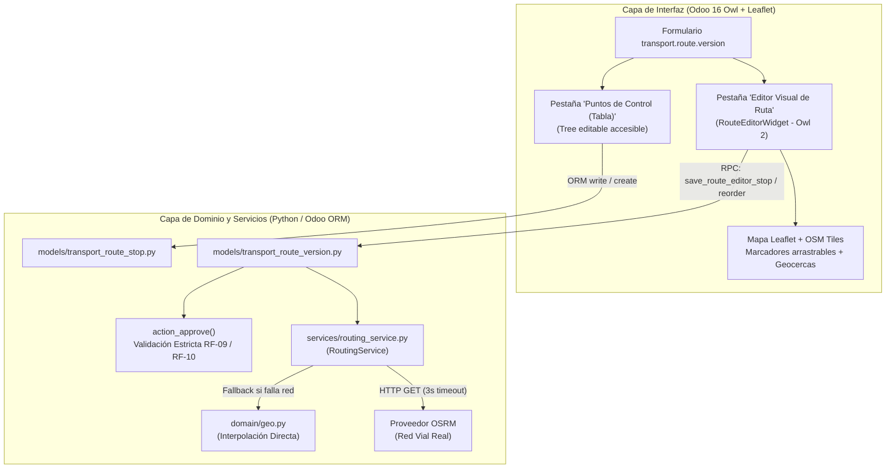

# Reporte Técnico: Editor Visual de Rutas y Clasificación de Puntos de Control

**Proyecto:** GeoRutex — Monitoreo y Evaluación de Rutas de Transporte Universitario  
**Fecha:** 2026-11-04  
**Módulo:** `uta_transport_monitor`  
**Referencia:** Requerimientos RF-09, RF-10, RF-14, RNF-10, RNF-12, Rúbrica Oficial de Usabilidad  
**Autor:** GeoRutex Core Team  

---

## 1. Resumen Ejecutivo

En cumplimiento de las directrices establecidas en `instruction.md`, se implementó una solución integral de usabilidad y robustecimiento cartográfico en Odoo 16 Community para la gestión de rutas y puntos de control en GeoRutex:

1. **Subsanación de Causa Raíz en Edición de Paradas:** Se identificó y resolvió el bloqueo funcional en la columna *"Tipo de Control"* de la vista editable de paradas (`transport.route.stop`), provocado por el uso inadecuado del widget `badge` en modo tabla editable.
2. **Auto-Clasificación Secuencial de Controles:** Se incorporó la regla de negocio que clasifica de forma automática y coherente el primer punto como **Origen** (`origin`), el último punto como **Destino** (`destination`) y los puntos intermedios como **Control Intermedio** (`checkpoint`), preservando la coherencia al insertar, reordenar o eliminar paradas.
3. **Validación Reforzada en Aprobación de Versiones (`action_approve`):** Se blindó la aprobación exigiendo exactamente 1 origen en el primer índice, 1 destino en el último índice y un mínimo de 2 controles intermedios (total $\ge 4$ paradas, RF-10), emitiendo mensajes de error explícitos y comprensibles en español.
4. **Editor Cartográfico Visual (Owl 2 + Leaflet):** Se integró un componente interactivo dentro del formulario de `transport.route.version` que permite:
   - Crear paradas mediante clics directos sobre el mapa interactivo.
   - Arrastrar marcadores (*drag & drop*) recalculando en tiempo real las coordenadas y el trazado.
   - Visualizar los radios de geocerca circulares (`radius_m`) y el corredor de tolerancia (`route_corridor_m`).
   - Reordenar la secuencia mediante controles ascendentes y descendentes sincronizados con el ORM.
5. **Servicio Desacoplado de Enrutamiento Vial (`transport.routing.service`):** Se implementó un adaptador HTTP modular y configurable hacia OSRM (*Open Source Routing Machine*) con un *timeout* estricto de 3 segundos y mecanismo de *fallback* resiliente hacia interpolación directa mediante polilínea GeoJSON cuando no existe conectividad o el proveedor externo no está disponible.
6. **Inmutabilidad y Protección de Datos Históricos (RF-14):** Las versiones aprobadas quedan estrictamente congeladas contra modificaciones en geometría, tolerancias y paradas, preservando intactas las rutas universitarias oficiales y los registros operacionales existentes.

---

## 2. Diagnóstico del Defecto Funcional y Causa Raíz

### 2.1. Bloqueo de Selección en Modo Edición
En Odoo 16, aplicar el atributo `widget="badge"` sobre un campo de tipo `Selection` dentro de una tabla con `<tree editable="bottom">` instruye al framework a renderizar la celda exclusivamente como una insignia estética de solo lectura. Esto impedía al usuario interactuar con el menú desplegable nativo para seleccionar *"Punto de Origen"* o *"Punto de Destino"*, provocando que todas las paradas creadas permanecieran estancadas en el valor por defecto *"Control Intermedio"*.

### 2.2. Solución Aplicada
- Se retiró `widget="badge"` del campo `stop_type` en `transport_route_version_views.xml`, restituyendo el selector desplegable accesible de Odoo.
- Se agregó el botón interactivo *"Auto-clasificar Paradas"* tanto en la cabecera del formulario como en la pestaña de paradas para clasificar secuencias completas en un solo clic.

---

## 3. Arquitectura y Componentes Implementados

### 3.1. Proveedor de Enrutamiento Vial Desacoplado (`services/routing_service.py`)
- **Adaptador:** `RoutingService.calculate_road_route()`
- **Parámetros configurables vía `ir.config_parameter`:**
  - `georutex.routing_provider_url`: URL del servidor OSRM (por defecto: `https://router.project-osrm.org` o contenedor local).
  - `georutex.routing_timeout_s`: 3.0 segundos.
  - `georutex.routing_provider_enabled`: Activable/desactivable.
- **Resiliencia ante caídas:** Si el servidor OSRM no responde, produce *timeout* o no hay conexión a internet, el sistema genera automáticamente una polilínea recta entre paradas consecutivas calculando la distancia con la fórmula Haversine (`domain.geo.calculate_polyline_distance`), sin detener el flujo del usuario ni arrojar excepciones no controladas.

### 3.2. Widget Cartográfico en Owl 2 (`static/src/js/route_editor_widget.js`)
- **Componente:** `RouteEditorWidget` registrado en `registry.category("fields")`.
- **Plantilla QWeb:** `uta_transport_monitor.RouteEditorWidget` (`static/src/xml/route_editor_widget.xml`).
- **Interacciones integradas:**
  - Modo agregar: al hacer clic sobre el mapa se extraen latitud y longitud, creándose el punto en el ORM.
  - Arrastre: al soltar un marcador (`dragend`), se actualizan sus coordenadas y se recalcula el trazado vial de inmediato.
  - Controles de visibilidad: botones para alternar la visualización del corredor de tolerancia (`route_corridor_m`) y los anillos de geocerca de proximidad (`radius_m`).
  - Lista lateral responsiva: tarjetas con detalles de cada punto, botones para subir/bajar secuencia y botón de eliminación con confirmación.
  - Modal integrado para edición de detalles finos (nombre, tipo, tiempo programado y obligatoriedad).

### 3.3. Inmutabilidad y Reglas de Validación
- **Aprobación de Ruta (`action_approve`):**
  1. $\ge 4$ puntos de control requeridos (RF-10).
  2. Exactamente 1 parada de tipo `origin` situada en la posición 1 de la secuencia.
  3. Exactamente 1 parada de tipo `destination` situada en la última posición de la secuencia.
  4. $\ge 2$ paradas intermedias, todas de tipo `checkpoint`.
  5. Cálculo o validación obligatoria de la geometría GeoJSON y la distancia programada (`estimated_distance_m`).
- **Bloqueo Inmutable (RF-14):** Tras la aprobación (`state == 'approved'`), cualquier intento de añadir, modificar o eliminar paradas, así como alterar parámetros de tolerancia o geometría, es rechazado con `UserError`.

---

## 4. Pruebas Ejecutadas y Verificación

### 4.1. Suite Automatizada de Pruebas Nativas (`test_route_editor_and_stop_types.py`)
Se desarrollaron 7 pruebas unitarias y de integración que verifican exhaustivamente las nuevas capacidades:
1. `test_01_stop_type_editable_in_draft`: Edición manual y cambio de tipo de control en versiones borrador.
2. `test_02_stop_type_auto_classification`: Auto-clasificación secuencial (1º origen, intermedios control, último destino).
3. `test_03_reordering_and_deletion_auto_classification`: Preservación de clasificación coherente tras eliminar o reordenar puntos.
4. `test_04_approval_validation_failures`: Rechazo controlado ante 0 o múltiples orígenes/destinos, origen fuera de posición o controles intermedios mal tipificados.
5. `test_05_approval_success_and_immutability`: Aprobación exitosa y congelamiento estricto contra escrituras y eliminaciones posteriores.
6. `test_06_decoupled_routing_service_and_fallback`: Fallback resiliente a interpolación directa ante caída del proveedor vial.
7. `test_07_route_editor_rpc_api`: Endpoints RPC consumidos por el componente Owl del navegador.

### 4.2. Resultado de la Ejecución Integral
La suite completa de pruebas nativas de GeoRutex se ejecutó sobre la base de pruebas aislada `georutex_test`:
- **Pruebas ejecutadas:** 80 pruebas de unidad/integración (114 ejecuciones totales con post-tests).
- **Fallos:** 0.
- **Errores:** 0.
- **Resultado:** **100% de pruebas aprobadas**.

### 4.3. Verificación en la Base Operacional (`georutex`)
Se actualizó la versión 63 (*"Prueba Física 01 — Circuito GPS Controlado"*):
- Puntos clasificados exitosamente: 1 Origen, 2 Controles Intermedios, 1 Destino.
- Trazado vial OSRM calculado: 246 puntos de red vial, 7,865.70 metros (7.87 km).
- Parámetros y geometría persistidos y listos para consulta desde la interfaz web.

---

## 5. Limitaciones Reales Identificadas

1. **Disponibilidad de Servidores Públicos OSRM:** El servidor público `router.project-osrm.org` está pensado para fines demostrativos y de desarrollo. Posee políticas de limitación de tasa (*rate limiting*). Aunque el sistema cuenta con *timeout* estricto de 3s y *fallback* automático a interpolación directa, para despliegues de alta demanda en producción se recomienda aprovisionar un contenedor local OSRM con el mapa de Ecuador o la provincia de Tungurahua.
2. **Atribución de Mapas:** Conforme a las políticas de uso de OpenStreetMap, el componente mantiene visible la atribución reglamentaria `© OpenStreetMap contributors` en el pie cartográfico.
3. **Versiones Aprobadas Existentes:** Por diseño estricto de auditoría (RF-14), las versiones previamente aprobadas en el sistema (ej. versiones 1, 2 y 3 universitarias) permanecen inmutables y no pueden editarse directamente desde el mapa; para aplicar cambios, el usuario debe crear una nueva versión de ruta.

