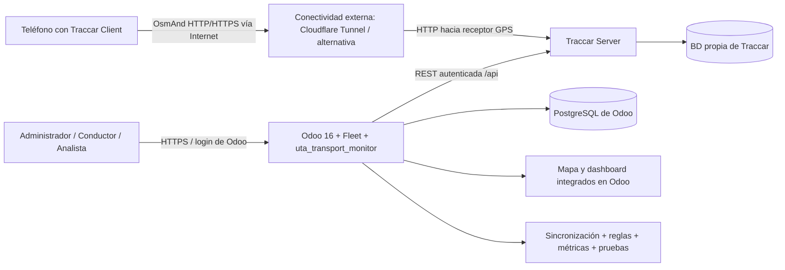
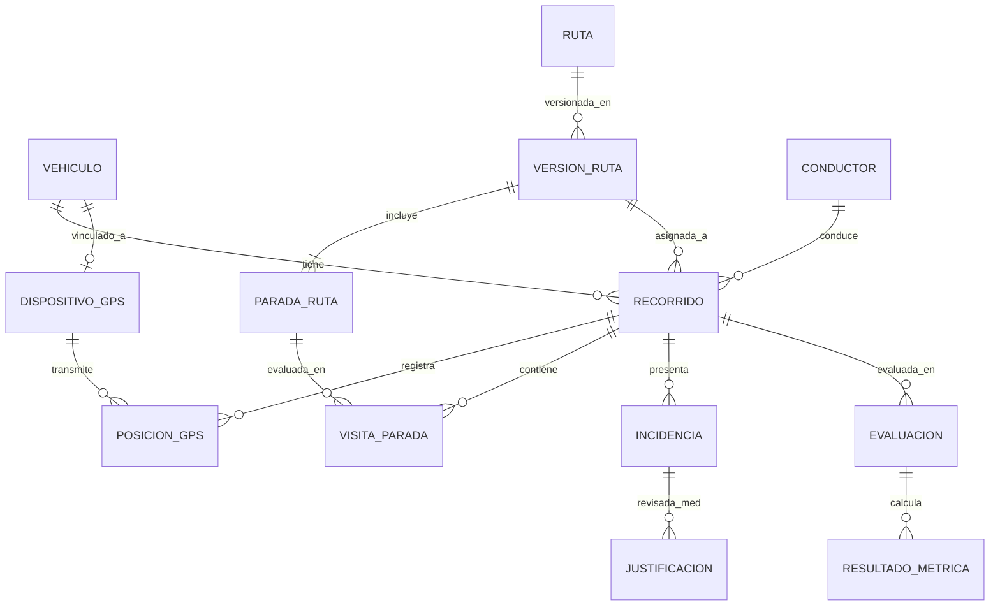

# GeoRutex — Especificación de requisitos del sistema de monitoreo y evaluación de rutas

**Producto:** **GeoRutex**  
**Nombre descriptivo:** GeoRutex — Sistema de Monitoreo y Evaluación de Rutas  
**Proyecto académico:** Sistema de Monitoreo y Evaluación de Rutas de Transporte Universitario mediante Odoo 16 y Traccar  
**Repositorio GitHub / carpeta raíz:** `georutex`  
**Módulo técnico Odoo:** `uta_transport_monitor`  
**Ubicación de este documento:** `docs/requirements.md`  
**Asignatura:** Gestión de Calidad del Software — Universidad Técnica de Ambato  
**Tipo:** Especificación funcional, técnica, de datos, de pruebas y de criterios de aceptación para la implementación de GeoRutex  
**Fecha de referencia:** 1 de noviembre de 2026  
**Idioma del sistema:** español  
**Zona horaria de negocio:** `America/Guayaquil` (UTC−05:00)

> **MANDATO DE IMPLEMENTACIÓN:** Construir un sistema **realmente funcional, integrado, demostrable y verificable**. No entregar maquetas desconectadas, datos inventados presentados como reales, dashboards de cifras fijas, pantallas que no guarden datos, cálculos sin respaldo ni integraciones simuladas como si estuvieran conectadas. Los datos de simulación, cuando existan, deben estar explícitamente identificados.

---

## 0. Contrato de lectura, fuentes y decisiones

### 0.1. Cómo utilizar este archivo

Este archivo es la **fuente de verdad de los requisitos**, criterios de aceptación y rúbrica del proyecto. El agente que asuma el proyecto por primera vez o haya perdido contexto debe leerlo **completamente una vez**, junto con `docs/architecture.md`, e inspeccionar el repositorio para reutilizar lo que ya funciona. En tareas posteriores, con contexto fiable, consultará las secciones 0 y 13, los RF/RNF afectados, sus criterios y las secciones relacionadas (especialmente 5–12 y 14–16). Releerá íntegramente el documento cuando cambie la arquitectura, la rúbrica o el alcance transversal. Ningún requisito se satisface únicamente porque aparezca una pantalla o exista código no ejecutado.

El agente debe:

1. Inspeccionar el estado real del repositorio, versiones, despliegue, módulos y servicios disponibles; **no asumir que ya existen**.
2. Construir primero la integración mínima completa Odoo ↔ Traccar con envío GPS externo, y luego ampliar la gestión, evaluación y métricas.
3. Mantener el núcleo de gestión en **Odoo 16**, no reemplazarlo por una aplicación web independiente.
4. Preferir un módulo propio de Odoo que **extienda** `fleet.vehicle` y añada modelos de transporte, sin modificar el código fuente de los módulos oficiales.
5. Implementar modelos, vistas, permisos, trabajos de sincronización, lógica geográfica, indicadores, pruebas y documentación de operación de manera coherente.
6. Registrar explícitamente los supuestos técnicos configurables y cualquier diferencia comprobada entre las APIs reales y los ejemplos de este documento.
7. No incorporar credenciales reales, claves API, tokens, contraseñas, identificadores personales ni datos GPS privados en el código, los tests o el repositorio.
8. Priorizar la corrección, reproducibilidad y trazabilidad de las métricas sobre efectos visuales o funciones adicionales.

### 0.2. Clasificación de las decisiones

- **[OFICIAL]**: requisito obligatorio del documento de proyecto `proyectoFinal_GC.pdf`. No puede eliminarse por conveniencia técnica.
- **[REUNIÓN]**: precisión, posibilidad o recomendación expresada el 30/10/2026 en `Texto pegado.txt`. Cuando no contradiga un mínimo explícito, ayuda a definir el alcance.
- **[DISEÑO]**: especificación técnica y regla concreta que se adopta en este documento para eliminar ambigüedades y permitir la programación. Es una **propuesta implementable**, no una cita del docente; debe quedar configurable cuando corresponda.
- **[OPCIONAL]**: mejora que no condiciona la aprobación del alcance mínimo.

**Orden de prioridad cuando exista conflicto:** mínimos y rúbrica oficiales → aclaraciones compatibles de la reunión → reglas de diseño aquí establecidas → funcionalidades opcionales. Ante una indicación oral ambigua, no rebajar un requisito escrito: implementar la variante que satisfaga ambos siempre que sea razonable.

### 0.3. Procedencia y precisiones importantes

| Tema | Determinación aplicable | Procedencia |
|---|---|---|
| Plataforma central | Odoo **16** y módulo Fleet; Traccar Server + Traccar Client para GPS | [OFICIAL], pp. 1–4 |
| Acceso externo | Cloudflare Tunnel **o alternativa equivalente**; debe recibir posiciones por datos móviles, no solo por la misma Wi-Fi | [OFICIAL], p. 3; [REUNIÓN], sección 8 |
| Cantidades mínimas | **2 vehículos, 3 rutas, 4 puntos por ruta, 10 recorridos de prueba** | [OFICIAL], pp. 4–5 |
| Dashboards | Dentro de Odoo; desarrollado con Odoo o BI externo integrado | [OFICIAL], pp. 7–8; [REUNIÓN], sección 7/sección 9 |
| Roles | El docente permite definirlos según análisis; propone administrador y conductores, con permisos segmentados | [REUNIÓN], sección 11/sección 13 |
| Incidencias | Automáticas por incumplimiento y reportadas manualmente por conductores; registrar causas de desvíos | [OFICIAL], pp. 5–6; [REUNIÓN], sección 3/sección 5/sección 6 |
| Datos históricos | Recorridos y posiciones verificables, sin duplicados inconsistentes | [OFICIAL], pp. 4–7; [REUNIÓN], sección 17 |
| Mapa | Puede integrarse un mapa propio o la interfaz de Traccar; **un iframe por sí solo no cubre gestión, historial, reglas y métricas** | [REUNIÓN], sección 16/sección 19/sección 21; [OFICIAL], pp. 3–9 |
| Datos temporales | Deben convertirse correctamente entre UTC y Ecuador UTC−5 | [REUNIÓN], sección 18 |
| Bases | Odoo debe usar PostgreSQL; Traccar puede tener una base distinta | [REUNIÓN], sección 14/sección 17; esquema oficial p. 13 |
| Implementación en Docker | **No está confirmada expresamente**: la respuesta oral fue ininteligible; el enunciado permite infraestructura disponible | [OFICIAL], p. 3; [REUNIÓN], sección 20 |
| Nombre de módulo de integración mencionado verbalmente | No fue distinguible; **no asumir** que exista un conector preciso llamado “Flip” | [REUNIÓN], sección 2 |
| Sustitución de Traccar | Aunque se mencionaron alternativas, Traccar figura expresamente en el encargo y la rúbrica; **mantener Traccar por defecto** | [OFICIAL], pp. 1–3 y 14; [REUNIÓN], sección 10 |
| App móvil propia | **No requerida**: Traccar Client cubre la captura de GPS | [REUNIÓN], sección 15 |

### 0.4. Alcance implementable elegido

**[DISEÑO] Identidad acordada:** nombre del producto **GeoRutex**, repositorio **`georutex`**, documentación en **`docs/`** y módulo técnico **`uta_transport_monitor`**. El nombre comercial no altera los mínimos del proyecto universitario.

**[DISEÑO] Decisiones predeterminadas** — no representan requisitos impuestos por el docente:

- Desarrollar el complemento Odoo 16 Community con identificador técnico fijo **`uta_transport_monitor`** y nombre visible asociado a **GeoRutex**; conservar el identificador técnico aunque el nombre comercial y el repositorio sean `GeoRutex` y `georutex`.
- Adoptar una arquitectura modular por capas compatible con el framework Odoo 16, separando servicios y reglas de negocio del acceso API Traccar y de las vistas, sin forzar Onion estricta.
- Extender `fleet.vehicle` y utilizar modelos propios de rutas, paradas, asignaciones, puntos GPS, visitas, incidencias, evaluaciones y métricas.
- Crear un **mapa nativo integrado en Odoo** con una biblioteca compatible con el frontend de Odoo 16 y cartografía abierta, antes que depender de un iframe de toda la interfaz Traccar. Si ya existe un iframe funcional, conservarlo como acceso auxiliar, sin sustituir la integración de datos por API.
- Priorizar un dashboard **nativo de Odoo** con filtros y gráficos; Power BI/Metabase queda como alternativa, no dependencia obligatoria.
- Implementar sincronización **programada e idempotente** mediante `ir.cron` más actualización manual; la actualización en vivo con WebSocket puede añadirse después. “Tiempo real” aquí significa datos actualizados con periodicidad conocida y estado de frescura visible, no prometer latencia cero.
- Mantener en `domain/` las funciones puras de geodesia, evaluación y métricas; en `services/` la orquestación; y en `integrations/` el adaptador HTTP Traccar. Ejecutar Pytest de dominio en entorno con **Odoo 16 instalado**, sin exigir conexión externa a Traccar; las pruebas nativas del ORM se ejecutan mediante el runner de Odoo.
- Localizar cadenas de interfaz mediante `i18n/es.po` (fuentes técnicas en inglés y textos visibles en español). El addon debe cargarse con idioma español en las demostraciones.
- Manejar 3 roles funcionales: **Administrador de transporte**, **Conductor** y **Consultor/Analista**. El rol de analista está justificado por la necesidad de consultar métricas sin permisos de edición; no se exige una aplicación pública para estudiantes.
- Utilizar Docker Compose para un entorno local reproducible **cuando sea viable**, con Odoo 16, PostgreSQL, Traccar y el túnel como servicio o configuración separada. Si el proyecto ya funciona en VM, mantener esa infraestructura y documentarla.
- Mantener Traccar como autoridad de posiciones GPS y Odoo como autoridad de entidades de negocio, asignaciones, incidencias locales y resultados.
- **Reutilizar antes de desarrollar desde cero:** usar Fleet para gestión básica de vehículos y Traccar para captura/historial GPS; considerar conectores Odoo–Traccar existentes **solo si se verifica compatibilidad con Odoo 16**, licencia, seguridad y sincronización real. No asumir compatibilidad de conectores orientados a Odoo 19 ni imponer compras de módulos comerciales. Si no hay uno apto, desarrollar un adaptador propio a la API Traccar sin cambiar la lógica de dominio.

### 0.5. Qué no debe confundirse con un requisito obligatorio

No se exige bus institucional real, IP pública, creación de aplicación móvil desde cero, Power BI obligatorio, solución de geocodificación comercial, seguimiento público para estudiantes, predicción de tráfico, mapas de calor, cobro de multas, cálculo de ETA por tráfico, producción con alta disponibilidad ni acceso de terceros. Son posibilidades mencionadas o extensiones futuras. Tampoco se exige que todos los escenarios de incumplimiento se produzcan físicamente: el documento oficial permite **datos simulados claramente señalizados** para probar reglas cuando sea impracticable reproducirlos.

---

## 1. Visión del producto y resultados de negocio

### 1.1. Problema

Se necesita controlar recorridos de transporte universitario mediante ubicaciones GPS y comprobar objetivamente el cumplimiento de trayectos, horarios y paradas. Sin plataforma centralizada, no se conoce la ubicación actual, se dificulta verificar atrasos y desvíos, no existe historial suficientemente analizable y no se generan métricas confiables de calidad del transporte ni del software.

### 1.2. Objetivo general

Implementar un sistema de monitoreo y evaluación de rutas de transporte universitario, integrado mediante **Odoo 16 + Traccar Server + Traccar Client + conectividad externa**, capaz de gestionar vehículos, rutas y paradas, registrar desplazamientos, detectar incidencias y calcular indicadores dinámicos de cumplimiento y de calidad del software, con evidencias de prueba y mejora continua.

### 1.3. Preguntas que la aplicación debe contestar con datos comprobables

1. ¿Dónde está o dónde estuvo por última vez cada vehículo? ¿Qué tan reciente y confiable es esa posición?
2. ¿Qué ruta tiene asignada en un horario y fecha concretos?
3. ¿Cuál es el trayecto programado y cuál fue el real?
4. ¿Cuáles paradas obligatorias visitó, cuándo, y cuáles omitió?
5. ¿Salió y llegó puntualmente? ¿Qué retraso acumuló?
6. ¿Se desvió del corredor de ruta? ¿Cuánto y durante cuánto tiempo? ¿Hubo una justificación?
7. ¿Cuántos recorridos completó y cuáles siguen pendientes o son evaluaciones inconclusas?
8. ¿Cuáles son las distancias previstas y efectivamente registradas?
9. ¿Qué incidencias automáticas o reportadas ocurrieron, con qué frecuencia y en qué rutas?
10. ¿Qué indicadores de calidad y confiabilidad del sistema se midieron realmente?
11. ¿Qué pruebas se ejecutaron, qué falló y qué mejora comprobable se realizó?

### 1.4. Casos básicos de uso

- **CU-01:** Administrador configura la conexión a Traccar y verifica el servicio.
- **CU-02:** Administrador registra un vehículo y enlaza su dispositivo GPS.
- **CU-03:** Administrador crea una ruta con polilínea, sentido, paradas y horarios.
- **CU-04:** Administrador agenda un recorrido para un vehículo y conductor.
- **CU-05:** Teléfono con Traccar Client transmite posiciones por una red externa.
- **CU-06:** El sistema sincroniza y muestra la última posición y trazado histórico.
- **CU-07:** El conductor consulta su recorrido y registra una incidencia.
- **CU-08:** El sistema determina inicio, visitas, fin, atrasos, desvíos y pérdida de señal.
- **CU-09:** Administrador revisa incidencias y registra justificaciones sin alterar evidencia GPS.
- **CU-10:** Analista filtra y compara indicadores por fechas, ruta y vehículo.
- **CU-11:** Administrador o evaluador ejecuta pruebas y revisa la trazabilidad de métricas.

---

## 2. Actores, permisos y seguridad funcional

### 2.1. Roles

**Administrador de transporte (`group_transport_manager`).** Puede crear y editar vehículos, vincular dispositivos, gestionar rutas, puntos de control y versiones, asignar viajes, parametrizar umbrales, consultar mapas e historiales de todos los vehículos, ejecutar sincronizaciones, revisar y justificar incidencias y ver reportes. La configuración sensible de integración se restringe al grupo de administrador del sistema, o a un grupo técnico separado.

**Conductor (`group_transport_driver`).** Puede consultar **solo sus recorridos asignados**, visualizar el estado y paradas de su jornada, registrar y consultar incidencias relacionadas con dichos recorridos, y solicitar inicio/fin cuando se habiliten controles operativos. No puede modificar rutas aprobadas, cambiar horarios, vincular dispositivos de terceros, alterar posiciones, aprobar sus propias justificaciones ni consultar credenciales de Traccar.

**Consultor o analista (`group_transport_analyst`).** Acceso de lectura a vehículos autorizados, recorridos, indicadores, incidencias y reportes; puede filtrar/exportar datos si está autorizado, pero no modifica los registros de referencia ni configura el sistema.

**Administrador técnico de Odoo.** Mantiene usuarios, grupos, infraestructura y credenciales. No es necesario crear una autenticación paralela.

### 2.2. Matriz de acceso mínima

| Recurso / acción | Administrador transporte | Conductor | Analista |
|---|:---:|:---:|:---:|
| Ver vehículos y última posición autorizada | Sí | Solo asignados | Sí |
| Crear, modificar y archivar vehículos | Sí | No | No |
| Vincular identificador de dispositivo GPS | Sí | No | No |
| Crear / modificar / archivar rutas y paradas | Sí | No | No |
| Crear / reasignar / cancelar recorridos | Sí | No | No |
| Ver historial GPS | Sí | Solo propio, alcance restringido | Sí |
| Declarar inicio / fin manual (si se habilita) | Sí | Solo propio | No |
| Registrar incidencia manual | Sí | Solo recorrido propio | No |
| Justificar / revisar / cerrar incidencia | Sí | No | No |
| Ver dashboard e indicadores | Sí | Vista básica de sus recorridos | Sí |
| Configurar conexión / ver secretos | Solo administrador técnico | No | No |
| Borrar físicamente posiciones / evaluaciones cerradas | No en operación ordinaria | No | No |

**Reglas de acceso:** implementar `ir.model.access.csv`, `res.groups` y `ir.rule` por registro en Odoo, además de verificar permisos en métodos, controladores y llamadas elevadas. No confiar en ocultar botones como único control. Los usuarios de Odoo no obtienen acceso directo al API Traccar mediante credenciales compartidas en el navegador.

### 2.3. Privacidad y auditoría

- Los recorridos contienen geolocalización personal potencialmente sensible: acceso por principio de mínimo privilegio.
- Retener autor, fecha y motivo de modificaciones de asignaciones, cierres, re-evaluaciones y justificaciones; registrar transiciones importantes con `mail.thread` o auditoría específica si está disponible.
- No permitir editar `lat`, `lon`, instante, `traccar_position_id` ni atribución de fuente de una posición importada.
- Los datos simulados deben verse como **SIMULADOS** en listas, mapas, detalles, exportaciones y reportes; no deben sumarse a indicadores de recorridos reales sin un filtro o desglose explícito.
- Proteger secretos en configuración servidor / variables de entorno, nunca en XML/JS o páginas consultables.

---

## 3. Requisitos funcionales detallados (RF)

**Convención:** cada `RF-XX` indica una obligación del sistema. La clasificación `P0` corresponde al núcleo irrenunciable y `P1` a capacidades necesarias para la evaluación completa; `P2` es una mejora opcional. Las comprobaciones indicadas constituyen **criterios de aceptación**.

### 3.1. Infraestructura y configuración

#### RF-01 [P0] — Desplegar Odoo 16 y Fleet

**Función:** el sistema tendrá una instancia utilizable de Odoo 16 con el módulo Fleet habilitado y el módulo propio instalado.  
**Aceptación:** iniciar sesión; abrir Fleet; crear, consultar y actualizar un vehículo; acceder al menú de Transporte; reiniciar la instancia sin pérdida de datos; identificar la versión de Odoo.  
**Origen:** [OFICIAL], Actividad 2.

#### RF-02 [P0] — Desplegar Traccar Server

**Función:** disponer de un servidor Traccar accesible mediante una API autenticada, capaz de registrar al menos dos dispositivos.  
**Aceptación:** el servidor responde; las credenciales técnicas son válidas; se listan los dispositivos; un teléfono publica posiciones observables en Traccar; se conservan tras reinicio.  
**Origen:** [OFICIAL], Actividad 2.

#### RF-03 [P0] — Configurar Traccar Client y conectividad externa

**Función:** permitir que Traccar Client envíe GPS por datos móviles desde fuera de la LAN.  
**Aceptación:** apagar Wi-Fi en el teléfono, habilitar datos móviles, generar nuevas posiciones, comprobar su recepción posterior en Traccar y sincronización en Odoo; conservar evidencia de conectividad y fecha/hora. Una prueba solo por localhost no aprueba este requisito.  
**Origen:** [OFICIAL], Actividad 2; [REUNIÓN], sección 8.

#### RF-04 [P0] — Configurar y probar conexión Odoo → Traccar

**Función:** pantalla de configuración accesible a administración técnica para URL base, mecanismo de autenticación permitido, conexión y política de sincronización.  
**Aceptación:** un botón «Probar conexión» distingue éxito, credenciales incorrectas, servidor inaccesible y respuesta inválida sin exponer secretos. Registrar última conexión exitosa y fallo resumido.  
**Origen:** [OFICIAL], Actividad 3; [REUNIÓN], sección 19.

#### RF-05 [P0] — Sincronización confiable e idempotente

**Función:** consumir posiciones de Traccar, guardar la información de análisis requerida y actualizar última ubicación de cada dispositivo/vehículo sin duplicaciones.  
**Aceptación:** sincronizar dos veces la misma ventana produce cero puntos duplicados; fallos temporales dejan registros previos intactos; se puede reintentar; cada punto retiene su identificador externo y procedencia; se identifica el último sincronizado.  
**Origen:** [OFICIAL], Actividad 3; [REUNIÓN], sección 17.

#### RF-06 [P0] — Estado del dispositivo y datos desactualizados

**Función:** mostrar «activo», «sin reporte reciente», «sin posición», «error de consulta» o estado equivalente, con momento del último dato.  
**Aceptación:** dejar de enviar GPS más allá del umbral configurado cambia el estado a desactualizado sin mantenerlo falsamente «en vivo»; la interfaz informa fecha y antigüedad.  
**Origen:** [OFICIAL], Actividad 3.

### 3.2. Catálogos y asignaciones

#### RF-07 [P0] — Registrar vehículos

**Función:** crear, editar, consultar, archivar y buscar vehículos aprovechando `fleet.vehicle`. Guardar código/placa o identificador de prueba, nombre, descripción, activo y referencia de dispositivo.  
**Aceptación:** existen por lo menos 2 vehículos distintos; campos requeridos y unicidad controlados; archivado preserva históricos; no se crean vehículos redundantes al sincronizar.  
**Origen:** [OFICIAL], Actividad 4.

#### RF-08 [P0] — Asociar dispositivo único a vehículo

**Función:** vincular un identificador interno de Traccar y el `uniqueId` que transmite Traccar Client a un vehículo de Odoo.  
**Aceptación:** no pueden existir dos vehículos activos ligados simultáneamente al mismo `deviceId` de Traccar; un dispositivo inexistente o incompatible produce error informativo; se muestra cuándo fue validado el vínculo. Para dos vehículos con transmisiones simultáneas se necesitan dos dispositivos Traccar independientes (habitualmente dos teléfonos); un único teléfono puede reasignarse solo en intervalos no solapados, con vigencia histórica auditable.  
**Origen:** [OFICIAL], Actividades 3–4; [REUNIÓN], sección 15.

#### RF-09 [P0] — Crear múltiples rutas

**Función:** registrar rutas con código, nombre, origen, destino, descripción, sentido, longitud estimada, geometría de referencia, estado y versión.  
**Aceptación:** se registran 3 rutas diferentes; cada ruta tiene trazado ordenado y longitud coherente; una ruta sin geometría no puede activarse para evaluación de desvíos.  
**Origen:** [OFICIAL], Actividad 4; [REUNIÓN], sección 1/sección 3.

#### RF-10 [P0] — Administrar paradas/puntos de control

**Función:** crear puntos de control con nombre, latitud, longitud, orden, obligatoriedad, radio de proximidad y horario relativo o previsto por recorrido.  
**Aceptación:** cada una de las 3 rutas activas tiene al menos 4 puntos de control; el orden se representa sobre el mapa; se comprueban coordenadas válidas, radios positivos y ausencia de órdenes duplicados.  
**Origen:** [OFICIAL], Actividad 4; [REUNIÓN], sección 3.

#### RF-11 [P0] — Definir horarios y tolerancias

**Función:** guardar hora prevista de inicio, llegada y paso por cada parada; configurar márgenes de puntualidad y reglas geográficas con valores predeterminados documentados.  
**Aceptación:** el sistema valida que los horarios sigan un orden temporal; distingue horario esperado de hora registrada; cambiar la tolerancia afecta nuevas evaluaciones de manera explícita y auditable.  
**Origen:** [OFICIAL], Actividades 4/6; [REUNIÓN], sección 4.

#### RF-12 [P0] — Asignar recorridos fechados

**Función:** asociar vehículo + conductor (cuando aplique) + ruta/versión + fecha + instante previsto de inicio y fin + horarios de paradas. Un vehículo puede realizar rutas distintas en horarios distintos.  
**Aceptación:** una unidad puede tener recorridos A y B el mismo día sin conflictos; no se admiten solapamientos incompatibles del mismo vehículo/dispositivo; cada instancia se identifica sin ambigüedad.  
**Origen:** [OFICIAL], Actividad 4.

#### RF-13 [P0] — Estados y ciclo de vida del recorrido

**Función:** gestionar `borrador → programado → en_curso → finalizado` y alternativas `cancelado`, `incompleto`, `datos_insuficientes`, según la evidencia disponible.  
**Aceptación:** los cambios inválidos se bloquean; no se evalúa una cancelación como incumplimiento ejecutado; se distingue finalización física de cierre administrativo; una reevaluación no modifica las observaciones GPS originales.  
**Origen:** [DISEÑO] derivado de [OFICIAL], Actividades 4–6.

#### RF-14 [P1] — Versionar rutas y parámetros de evaluación

**Función:** congelar en el recorrido la versión y parámetros del trazado aprobados al programarlo.  
**Aceptación:** editar una ruta posterior no mueve las paradas históricas ni altera el resultado de un recorrido antiguo automáticamente; la reevaluación voluntaria deja huella.  
**Origen:** [DISEÑO] para la integridad histórica exigida por [OFICIAL].

### 3.3. Seguimiento GPS y recorridos

#### RF-15 [P0] — Última ubicación GPS por vehículo

**Función:** mostrar posición, última fecha y hora, velocidad disponible, estado de frescura y ruta actual.  
**Aceptación:** al recibir un punto nuevo se actualiza marcador/detalle; si falta posición, mostrar «sin datos» y no coordenadas inventadas; la fecha local se corresponde con el instante UTC recibido.  
**Origen:** [OFICIAL], Actividades 3/8.

#### RF-16 [P0] — Mapa de seguimiento en Odoo

**Función:** mapa accesible desde Odoo con vehículos autorizados, últimas posiciones, leyenda de estado, ruta programada y marcadores de paradas.  
**Aceptación:** se identifican los vehículos y su ubicación; zoom/centrado funciona; se distinguen paradas y dirección del recorrido; la vista reacciona a datos reales sincronizados.  
**Origen:** [OFICIAL], Actividades 3/8; [REUNIÓN], sección 16.

#### RF-17 [P0] — Historial de posiciones por recorrido

**Función:** consultar puntos GPS ordenados por tiempo, ruta efectiva como polilínea y detalle (latitud, longitud, tiempo y velocidad).  
**Aceptación:** elegir un recorrido muestra solo puntos del dispositivo/ventana asignada y permite consultar su origen; un viaje con registros insuficientes se señala como tal.  
**Origen:** [OFICIAL], Actividades 3/5/8.

#### RF-18 [P0] — Persistir evidencias del recorrido

**Función:** conservar vehículo, ruta y versión, fecha, posiciones, velocidad, horario previsto/real de inicio y fin, distancia planificada/real, visitas a paradas e incidencias.  
**Aceptación:** al reiniciar Odoo y Traccar el historial sigue disponible y se puede volver a calcular; un registro permite rastrear los puntos utilizados en su evaluación.  
**Origen:** [OFICIAL], Actividad 5.

#### RF-19 [P0] — Ejecutar pruebas de desplazamiento

**Función:** soportar al menos 10 recorridos documentados distribuidos entre las 3 rutas, con casos conformes y no conformes.  
**Aceptación:** existen 10 asignaciones realizadas/evaluadas con fuentes y resultados visibles; el sistema diferencia fuentes **REAL** (capturadas por Traccar Client) y **SIMULADA**; se demuestra como mínimo un recorrido real y un incumplimiento. No contar planes aún no ejecutados.  
**Origen:** [OFICIAL], Actividades 5/8 y defensa.

#### RF-20 [P1] — Inicio y fin reales verificables

**Función:** establecer el inicio real mediante la **primera salida confirmada del radio de origen después de una presencia de origen confirmada**, y el fin real mediante la **primera entrada confirmada al radio de destino** posterior al inicio, respetando el sentido, la precisión y el orden de `fixTime`. El instante de entrada/salida se atribuye a la primera muestra que cumple la transición; nunca al instante de sincronización. La confirmación y los casos sin evidencia se rigen por la sección 7.4 y la sección 7.8.

**Aceptación:** si la primera posición observada ya está fuera del origen sin presencia anterior confirmada, `actual_start_utc` permanece desconocido; si falta la entrada confirmada al destino, `actual_end_utc` permanece desconocido. Una declaración manual del conductor se conserva separada, no sustituye observaciones GPS. Registrar método y posiciones respaldatorias; los indicadores temporales/distancia se calculan solo cuando hay límites verificables y calidad suficiente.

**Origen:** [DISEÑO] para hacer medibles [OFICIAL], Actividades 5–7.

#### RF-21 [P1] — Actualización automática y refresco manual

**Función:** aplicar un `ir.cron` de sincronización y un botón «Sincronizar ahora», sujetos a permisos.  
**Aceptación:** un punto que llega a Traccar aparece en Odoo tras el ciclo de sincronización; el usuario ve última actualización; el cron no bloquea innecesariamente la interfaz ni crea duplicados.  
**Origen:** [DISEÑO] derivado de [OFICIAL], Actividades 3/8.

### 3.4. Incumplimientos, incidencias y explicación

#### RF-22 [P0] — Detectar retrasos

**Función:** comparar horas reales y previstas de inicio, paso por parada y fin usando tolerancias configuradas.  
**Aceptación:** una llegada 8 minutos después de lo previsto con tolerancia 5 se registra como **8 minutos de retraso** e incumplimiento de puntualidad; no restar tolerancia al retraso observado.  
**Origen:** [OFICIAL], Actividad 6, ejemplo explícito.

#### RF-23 [P0] — Detectar visita o incumplimiento de paradas

**Función:** determinar si el GPS entró al radio de cada parada, respetando orden/dirección y condiciones de validación.  
**Aceptación:** al entrar al radio se registra la primera llegada validada; una parada omitida queda incumplida cuando exista evidencia suficiente de que el recorrido prosiguió/finalizó; ausencia de GPS produce «no determinable» cuando no pueda probarse la omisión.  
**Origen:** [OFICIAL], Actividad 6; [REUNIÓN], sección 3/sección 4.

#### RF-24 [P0] — Detectar desviaciones del trazado

**Función:** comparar puntos GPS válidos con **todos los segmentos** de la polilínea o corredor planificado y generar eventos de desvío cuando se exceda la tolerancia geográfica configurada.  
**Aceptación:** un recorrido por calles diferentes puede marcar desvío aunque llegue al destino; evitar medir solo la distancia entre origen y destino; conservar distancia máxima, número de puntos y período fuera de corredor.  
**Origen:** [OFICIAL], Actividad 6; [REUNIÓN], sección 5.

#### RF-25 [P0] — Detectar recorridos incompletos

**Función:** clasificar viajes que no alcanzan el destino/puntos obligatorios con evidencia suficiente o que terminan sin completarse dentro de una ventana definida.  
**Aceptación:** un recorrido sin fin verificable queda `incompleto` o `datos_insuficientes` según el contexto; no convertir automáticamente una interrupción de señal en una ruta omitida sin evidencia.  
**Origen:** [OFICIAL], Actividad 6.

#### RF-26 [P0] — Detectar pérdida de señal o datos GPS desactualizados

**Función:** identificar gaps entre puntos durante ventanas de seguimiento y períodos sin información; generar eventos medibles.  
**Aceptación:** al superar el intervalo máximo se registra evento GPS; al reanudar se cierra su duración cuando corresponda; la falta de señal afecta el nivel de confianza de la evaluación.  
**Origen:** [OFICIAL], Actividad 6.

#### RF-27 [P0] — Registrar incidencias manuales

**Función:** administrador/conductor autorizado puede registrar choque, congestión, daño del vehículo, llanta pinchada, bloqueo de vía, desvío justificado u otra incidencia con descripción, fecha, ubicación y recorrido.  
**Aceptación:** la incidencia conserva autor, origen manual, hora y recorrido; el conductor solo registra en viajes propios; figura en el historial y en las estadísticas.  
**Origen:** [REUNIÓN], sección 3/sección 5/sección 6/sección 11; [OFICIAL], Actividad 1.

#### RF-28 [P0] — Incidencias automáticas tipificadas

**Función:** generar eventos de atraso, omisión, desvío, recorrido incompleto, diferencia temporal y pérdida de señal, con severidad, tipo, fuente y referencia a puntos/visitas.  
**Aceptación:** recálculo idéntico no multiplica incidencias; eventos similares de una misma ventana se agrupan según una regla verificable; cada incidencia explica qué umbral incumplió.  
**Origen:** [OFICIAL], Actividad 6.

#### RF-29 [P1] — Revisar y justificar incidencias sin borrarlas

**Función:** administrador puede aprobar/rechazar una justificación con motivo, adjunto opcional y fecha. El evento automático permanece auditable.  
**Aceptación:** un desvío por vía cerrada sigue existiendo, pero queda marcado como justificado; las métricas separan desvíos totales de no justificados; un conductor no puede autoaprobarse.  
**Origen:** [REUNIÓN], sección 5; [DISEÑO].

#### RF-30 [P1] — Evaluar cumplimiento integral

**Función:** calcular por recorrido estado de finalización, visitas, puntualidad y adherencia a ruta, mostrando causas específicas del resultado.  
**Aceptación:** los criterios están implementados como reglas versionadas; un recorrido 100 % conforme es visible; otro con una omisión/desvío/retraso muestra componentes afectados y no oculta la causa.  
**Origen:** [OFICIAL], Actividades 6–7; [REUNIÓN], sección 3.

### 3.5. Indicadores, informes y consultas

#### RF-31 [P0] — Ocho métricas de transporte obligatorias

**Función:** calcular (1) cumplimiento de rutas, (2) puntualidad, (3) retraso promedio, (4) paradas cumplidas, (5) desviación de ruta, (6) diferencia de distancias, (7) tiempo promedio de recorrido y (8) número/frecuencia de incidencias.  
**Aceptación:** todas constan con fórmula, unidad, fuente, valor e interpretación; recalcular un período produce resultados reproducibles; no usar valores fijos.  
**Origen:** [OFICIAL], Actividad 7.

#### RF-32 [P0] — Cuatro métricas de calidad de software obligatorias

**Función:** medir integridad GPS, exactitud Traccar–Odoo, tiempos de respuesta y detección correcta de incidencias.  
**Aceptación:** contar con muestra real o casos etiquetados, fórmula, fuente y unidad; nunca mostrar un «100 %» cuando no hay mediciones o la muestra está vacía.  
**Origen:** [OFICIAL], Actividad 7.

#### RF-33 [P0] — Dashboard dentro de Odoo

**Función:** panel con mapa/ubicación, resumen por ruta/vehículo, cumplimiento, puntualidad, retrasos, distancias, recorridos e incidencias.  
**Aceptación:** accesible desde menú de Odoo, con valores derivados de base de datos, sin cargar una aplicación externa independiente como sustituto; gráficos y tarjetas concuerdan con detalle.  
**Origen:** [OFICIAL], Actividad 8.

#### RF-34 [P0] — Filtros y comparaciones dinámicas

**Función:** filtrar por fecha o rango local, ruta, vehículo, conductor autorizado, tipo de incidencia y modalidad de dato real/simulado; comparar rutas y períodos.  
**Aceptación:** «Ayer», «Hoy», «Últimos 7 días» y rango personalizado devuelven los recorridos correctos en zona `America/Guayaquil`; filtros afectan todas las métricas relacionadas; pueden compararse al menos dos rutas.  
**Origen:** [OFICIAL], Actividad 8; [REUNIÓN], sección 7.

#### RF-35 [P0] — Detalle auditable de cada KPI

**Función:** permitir navegar desde indicador hasta sus recorridos, visitas e incidencias de origen, y disponer de una tabla de resultados con fórmula y denominador.  
**Aceptación:** seleccionar porcentaje de puntualidad permite verificar numerador y denominador; diferencia distancia muestra km previstos y observados; para ausencia de muestra mostrar «Sin datos», no 0 % engañoso.  
**Origen:** [OFICIAL], Actividades 7–8.

#### RF-36 [P1] — Exportación de resultados

**Función:** generar CSV o XLSX de recorridos, visitas, incidencias e indicadores filtrados, conservando zona horaria, origen de dato, período y unidades.  
**Aceptación:** los totales exportados coinciden con filtros de la interfaz; cada archivo incluye o acompaña la fecha de generación y parámetros de consulta.  
**Origen:** [DISEÑO] (útil, no expresamente obligatorio).

#### RF-37 [P1] — Informe histórico por recorrido

**Función:** vista imprimible o informe dentro de Odoo que resuma ruta planificada vs realizada, tiempos previstos/reales, paradas, desvíos, incidencias y evaluación.  
**Aceptación:** se puede abrir un recorrido terminado y consultar su ficha completa sin editar los datos base; valores auditables.  
**Origen:** [OFICIAL], Actividades 5/8.

### 3.6. Pruebas y calidad integradas al trabajo

#### RF-38 [P0] — Suite automatizada

**Función:** disponer de pruebas ejecutables para reglas de tiempo, geofencing, desvíos, distancias, sincronización, incidencias e indicadores, mediante herramientas compatibles con Odoo (tests Odoo y/o Pytest en módulos puros).  
**Aceptación:** las pruebas se ejecutan mediante un comando documentado; fallan ante regresiones; pueden ejecutarse sin acceder a Traccar externo mediante dobles de prueba.  
**Origen:** [OFICIAL], Actividad 9.

#### RF-39 [P0] — Pruebas funcionales, integración y rendimiento

**Función:** elaborar **como mínimo 10 casos** con entrada, esperado, obtenido, estado y evidencia; incluir caja negra, caja blanca, integración y rendimiento.  
**Aceptación:** cada caso tiene un ID y un requisito asociado; se adjuntan logs/capturas/mediciones, no solo declaración «aprobado».  
**Origen:** [OFICIAL], Actividad 9.

#### RF-40 [P0] — SonarQube y ISO/IEC 25010

**Función:** someter código propio a análisis estático con SonarQube y relacionar resultados de las pruebas con atributos pertinentes de ISO/IEC 25010.  
**Aceptación:** conservar reporte de escaneo real, incidencias y acciones; exponer evaluación de fiabilidad, seguridad, mantenibilidad, eficiencia y adecuación funcional apoyada en mediciones; no inventar indicadores de SonarQube.  
**Origen:** [OFICIAL], Actividad 9.

#### RF-41 [P0] — Mejora continua con antes/después

**Función:** registrar al menos un defecto observado en desarrollo/pruebas, su análisis causal mediante Ishikawa, Pareto cuando proceda, ciclo PDCA y evidencia cuantitativa antes/después.  
**Aceptación:** se identifica un defecto real, se demuestra reproducción, se aplica corrección y se repite la medición; si no hay datos suficientes para Pareto, justificarlo y no inventar frecuencias.  
**Origen:** [OFICIAL], Actividad 10.

---

## 4. Requisitos no funcionales (RNF)

Los umbrales numéricos señalados con **[DISEÑO]** son objetivos verificables de la implementación, **no cifras impuestas en el documento oficial**. Deben registrarse junto con el hardware y tamaño de muestra usado en las mediciones.

| ID | Requisito y condición observable | Criterio medible | Origen |
|---|---|---|---|
| RNF-01 | Compatibilidad de plataforma | Odoo **16** operativo, módulo Fleet instalado, Python y PostgreSQL compatibles con la versión elegida | [OFICIAL] |
| RNF-02 | Interoperabilidad | Odoo recupera dispositivos, posiciones e histórico de Traccar por API autenticada | [OFICIAL] |
| RNF-03 | Conectividad fuera de LAN | Teléfono con solo datos móviles consigue enviar posiciones; se demuestra recepción y consumo posterior desde Odoo | [OFICIAL] |
| RNF-04 | Integridad e idempotencia | Reimportar exactamente los mismos puntos conserva el mismo número de registros; identidades foráneas consistentes | [OFICIAL] |
| RNF-05 | Seguridad basada en roles | Pruebas de acceso positivas y negativas para administrador, conductor y analista; endpoints y métodos respetan permisos | [REUNIÓN]/[DISEÑO] |
| RNF-06 | Confidencialidad | Secretos fuera del repositorio; contraseñas y tokens no aparecen en HTML, logs ni respuestas de error | [DISEÑO] |
| RNF-07 | Consistencia temporal | UTC en persistencia técnica y conversión a `America/Guayaquil` para horarios de negocio y filtros | [REUNIÓN] |
| RNF-08 | Disponibilidad del historial | Los datos ya almacenados siguen consultables si Traccar está desconectado; alerta de falta de actualización | [DISEÑO] |
| RNF-09 | Rendimiento de consulta | **Objetivo inicial:** p95 ≤ 3 s para lista filtrada, dashboard y detalle sobre dataset de prueba, sin contar carga externa de tiles; medir y justificar si se incumple | [DISEÑO] |
| RNF-10 | Sincronización | **Objetivo inicial:** sincronización automática cada 30 s o 60 s, parametrizable; medir latencia extremo a extremo; no declarar actualización «en vivo» sin dato reciente | [DISEÑO] |
| RNF-11 | Escalabilidad de consulta | Probar al menos 100, 1.000 y 10.000 posiciones sintéticas y comparar tiempos; paginar listas y limitar consultas | [DISEÑO] |
| RNF-12 | Precisión de métricas | Fórmulas versionadas, unidades visibles, datos de origen rastreables, redondeo solo en presentación | [OFICIAL] |
| RNF-13 | Observabilidad | Registrar duración de sincronizaciones, cantidad recibida/insertada/descartada, errores y fecha de éxito | [DISEÑO] |
| RNF-14 | Recuperación | Reiniciar servicios y recuperar estado desde almacenamiento persistente; respaldo y restauración ensayables | [DISEÑO] |
| RNF-15 | Mantenibilidad | Lógica GPS y matemática separada de vistas; herencia Odoo en lugar de modificar núcleo; escaneo SonarQube real | [OFICIAL]/[REUNIÓN] |
| RNF-16 | Testabilidad | Reglas puras bajo pruebas deterministas; dependencias API sustituibles por dobles de prueba; al menos 10 casos documentados | [OFICIAL] |
| RNF-17 | Usabilidad e idioma | Con idioma `es` activado, **100 % de las cadenas propias visibles** en los flujos principales (menús, conductor, formularios, dashboard Owl, validaciones y reportes) aparecen en español; comprobar extracción/catálogo `i18n/es.po`, `_t`/`_()` según Odoo 16 e inspección funcional; etiquetas claras, unidades métricas y fecha local | [DISEÑO] |
| RNF-18 | Accesibilidad básica | No depender solo de colores para «activo», «desviado», «atrasado»; acompañar con texto e iconos | [DISEÑO] |
| RNF-19 | Portabilidad | Variables de entorno y documentación reproducible para máquina local o virtual; sin rutas absolutas de un equipo del grupo | [DISEÑO] |
| RNF-20 | Protección de datos de pruebas | Identificar datos sintéticos, usar cuentas de prueba, evitar publicar ubicaciones domiciliarias reales en capturas | [DISEÑO] |
| RNF-21 | Disponibilidad de servicios externos | Si mapa, túnel o Traccar fallan, mostrar error recuperable sin perder la sesión ni corromper la base | [DISEÑO] |
| RNF-22 | Calidad según ISO/IEC 25010 | Evaluar al menos adecuación funcional, eficiencia de desempeño, compatibilidad, fiabilidad, seguridad, mantenibilidad y usabilidad con evidencia pertinente | [OFICIAL]/[DISEÑO] |

**Condiciones de medición [DISEÑO]:** identificar equipo CPU/RAM, entorno, volumen de datos, número de repeticiones, herramienta y percentiles. No atribuir al curso umbrales de rendimiento no mencionados por el docente.

---

## 5. Arquitectura técnica y límites de responsabilidad

### 5.1. Arquitectura objetivo



**Flujo primario:**

1. Traccar Client obtiene coordenadas y tiempo en teléfono, con permisos y precisión habilitados.
2. Publica solicitudes al **receptor de protocolo GPS de Traccar**, no al puerto de la interfaz web ni directamente a Odoo.
3. Traccar valida, identifica dispositivo y guarda posiciones en su propia base de datos.
4. Un servicio de sincronización de Odoo consulta API de Traccar con autenticación de servidor a servidor.
5. Odoo enlaza posiciones con su vehículo y la instancia de recorrido correspondiente; persiste un subconjunto histórico trazable para análisis y auditoría.
6. El motor de evaluación detecta visitas, tiempos, trayectorias, señales e incumplimientos.
7. Los resultados se agregan en indicadores consultables y gráficos **dentro de Odoo**.
8. Los usuarios autorizados acceden a mapas, vistas de detalle, filtros y reportes sin iniciar sesión directamente en Traccar para sus tareas habituales.

### 5.2. Separación de responsabilidades

| Componente | Responsabilidad principal | No asumir |
|---|---|---|
| Traccar Client | Capturar/enviar ubicación GPS | Que el intervalo configurado garantice un punto cada N segundos |
| Traccar Server | Recibir protocolos de seguimiento, guardar dispositivos/posiciones, exponer API | Que conoce la ruta comercial planificada de Odoo |
| Odoo Fleet | Catálogo y gestión base de vehículos | Que ya implementa rutas, geocercas, horarios y métricas del proyecto |
| Módulo propio Odoo | Rutas, paradas, recorridos, vinculación, evaluaciones, incidentes, seguridad y dashboard | Que un iframe sustituye los modelos y reglas de negocio |
| PostgreSQL Odoo | Persistencia de negocio, snapshots GPS necesarios, resultados y auditoría | Que sea conveniente escribir directamente en tablas Traccar |
| BD Traccar | Fuente de verdad de posiciones y dispositivos externos | Que deba compartir esquema lógico con Odoo |
| Túnel/VPN/nube | Acceso externo al receptor Traccar y a interfaces autorizadas | Que cualquier protocolo se publique automáticamente por un túnel HTTP |
| Mapa | Representación de datos obtenidos vía API/BD Odoo | Que la cartografía determine sola si hubo incumplimiento |

### 5.3. Consideraciones de protocolo y puertos

**Advertencia técnica crítica:** Traccar Client moderno utiliza normalmente el protocolo **OsmAnd**, basado en HTTP; Traccar documenta habitualmente el **puerto 5055** para ese receptor. La interfaz/API de Traccar suele estar en **8082**, y Odoo suele exponer **8069**. **No son puertos intercambiables.** Confirmar en la instalación real versión, receptor, esquemas HTTP/HTTPS, host/puerto y configuración de red; ninguno de estos valores es inmutable.

En una publicación de Cloudflare Tunnel que expone un hostname HTTPS, el servicio interno puede ser `http://traccar:5055`, si se ha verificado que Cloudflare enruta correctamente la solicitud HTTP al receptor. Ejemplo conceptual:

```text
Traccar Client → https://gps.ejemplo-dominio.tld → Cloudflare → receptor OsmAnd Traccar:5055
Odoo (servidor) → http://traccar:8082/api/... → API Traccar
Navegador → https://odoo.ejemplo-dominio.tld → Odoo:8069 (si se publica)
```

`gps.ejemplo-dominio.tld` es ilustrativo, **no un dominio disponible ni una credencial real**. No asumir que un túnel de hostname público transporta UDP arbitrario o un protocolo TCP específico sin adaptación. Para clientes nuevos, validar primero OsmAnd y HTTP/HTTPS; si se usa VPN, los clientes y servidor deben tener rutas y autorizaciones efectivas. Si se usa Cloudflare Access, comprobar que no introduzca una pantalla de inicio de sesión incompatible con el cliente automático GPS. Mantener la API administrativa de Traccar restringida a la red interna siempre que sea posible.

### 5.4. Implementación modular Odoo 16

**Módulo recomendado:** `uta_transport_monitor` (`__manifest__.py` con dependencia al menos de `base` y `fleet`; `web`, `mail` solo cuando se utilicen sus componentes). La **ubicación canónica** de cada responsabilidad es:

- `models/`: extensión de `fleet.vehicle` y modelos ORM de rutas, paradas, versiones, viajes, GPS, visitas, incidencias y resultados.
- `services/gps_sync.py`: coordinación transaccional de sincronización, cursores, reconciliación e idempotencia usando el adaptador.
- `services/trip_service.py`: casos de uso de programación, asociación de puntos, evaluación y persistencia; puede dividirse en servicios cohesionados cuando exista necesidad real.
- `domain/geo.py`: Haversine, punto-segmento/polilínea, validación de saltos y radio de paradas; **sin ORM ni llamadas externas**.
- `domain/evaluation.py`: reglas puras y deterministas para tiempos, paradas, desviaciones, gaps y estados.
- `domain/metrics.py`: fórmulas y agregaciones puras de KPI sobre datos ya filtrados y validados; el acceso a registros y la autorización permanecen en la capa de aplicación.
- `integrations/traccar_client.py`: cliente HTTP autenticado de Traccar, normalización de respuestas, timeouts, reintentos limitados y excepciones tipadas.
- `security/`: grupos, ACL y reglas por registro.
- `views/`: formularios, listas, búsqueda, menú, acciones, dashboard y mapas.
- `static/src/`: componentes Owl/JavaScript compatibles con Odoo 16 y estilos del módulo.
- `data/`: cron, categorías y parámetros seguros.
- `demo/`: datos de demostración **rotulados como simulados**, opcionales; no equivalen a recorridos realmente ejecutados.
- `i18n/es.po`: traducción de interfaz visible al español desde las cadenas fuente del módulo.
- `static/description/`: icono y descripción del addon, con licencias pertinentes.
- `tests/`: pruebas nativas Odoo, con `tests/__init__.py` importando explícitamente los módulos de prueba.

**Regla anti-duplicación:** no crear `services/traccar_client.py`, `services/geo.py`, `services/evaluation.py` o `services/metrics.py` como una segunda implementación de la misma responsabilidad. Las importaciones normales deben respetar el paquete definido. `docs/architecture.md` sección 3 detalla las dependencias y sección 5 las pruebas.

**Implementar vistas usando mecanismos de Odoo 16.** No crear Next.js/React como sistema principal ni usar APIs Owl exclusivas de versiones posteriores. Se puede usar Leaflet u otra biblioteca cartográfica compatible, empaquetada con atribución/licencia apropiada; verificar permisos del proveedor de mapas y configurar errores. La persistencia y los KPIs se calculan en el backend, no en el navegador.

### 5.5. Sincronización y actualización

**Algoritmo de sincronización propuesto [DISEÑO]:**

1. Listar únicamente dispositivos enlazados y autorizados.
2. Para cada dispositivo, consultar puntos desde un cursor temporal conservando un pequeño **solapamiento de seguridad** de minutos, y hasta un instante UTC definido.
3. Buscar por `traccar_position_id`; insertar si no existe, o ignorar si ya fue procesado. Si una API cambia identificadores, utilizar clave estable compuesta de fuente+dispositivo+instante+secuencia/firma, no solo lat/lon.
4. Validar formato, campos obligatorios y sanidad básica; separar puntos inválidos/descartados con motivo.
5. Actualizar última posición aceptada **sin retroceder** si llegan puntos históricos fuera de orden.
6. Asociar cada punto con un solo recorrido compatible de ese dispositivo/ventana, o dejarlo como sin asignación para revisión; no atribuir indiscriminadamente al primer viaje del día.
7. Re-evaluar únicamente los viajes afectados y los agregados correspondientes; controlar concurrencia de cron y sincronización manual.
8. Guardar en log número consultado/insertado/duplicado/rechazado, duración, resultado y momento.
9. Avanzar cursor solo cuando la ventana se procesó correctamente; no perder puntos por fallos intermedios.

**Errores que deben manejarse:** `401/403` autenticación/autorización, `429` tasa, `5xx`, timeouts, HTML devuelto en vez de JSON, dispositivo eliminado, cero puntos, tiempos fuera de rango, JSON incompleto, conflicto de identificador y caída del túnel. Reintentos limitados con backoff para fallos transitorios, sin bucles infinitos.

**Control de concurrencia:** bloquear/rechazar dos sincronizaciones sobre la misma ventana/dispositivo o usar upserts transaccionales con restricción de unicidad. Evitar consultas masivas sin paginación/segmentación temporal.

### 5.6. API de integración Traccar: referencia, no sustituto de verificar versión

Puntos de entrada oficiales útiles (el servidor real puede tener una versión diferente de la última documentación pública):

| Operación | Endpoint de referencia | Uso |
|---|---|---|
| Dispositivos | `GET /api/devices` | Obtener IDs y metadatos de dispositivos |
| Últimas posiciones | `GET /api/positions` | Estado de posiciones más recientes, según parámetros y permisos |
| Posiciones en fechas | `GET /api/reports/route?deviceId=...&from=...&to=...` | Recuperar historia de puntos de dispositivo y período |
| Posiciones específicas | `GET /api/positions?...` | Consulta por IDs/fechas, según contrato exacto de versión |
| Información de sesión | `GET /api/session` / `POST /api/session` | Comprobar o establecer sesión según autenticación elegida |
| Actualizaciones live [OPCIONAL] | `GET /api/socket` (WebSocket) | Requiere autorización compatible y manejo correcto de sesión |

Documentación oficial: <https://www.traccar.org/traccar-api/>, <https://www.traccar.org/api-reference>, <https://www.traccar.org/client-configuration/>, <https://www.traccar.org/osmand/>.

**Precauciones:**

- La API REST puede admitir autenticación por sesión/cookie, Basic o token según configuración/versión; elegir **un método** efectivamente probado.
- `deviceId` numérico interno de Traccar y `uniqueId` del dispositivo móvil son **datos distintos**. No enviar uno donde se espera el otro.
- Traccar puede representar `speed` en **nudos**; convertir explícitamente a km/h al mostrar (`km/h = knots × 1.852`), verificando el contrato de la API usada. No asumir que ya está en km/h.
- Distinguir `deviceTime`, `fixTime` y `serverTime`; usar `fixTime` validado o el instante de captura apropiado para análisis temporal y reservar `serverTime` para diagnóstico de latencia/recepción. Documentar la elección.
- No dar por existente un endpoint REST de «recorridos de negocio» que incluya automáticamente las asignaciones de Odoo: el historial GPS y el modelo de viaje programado deben conciliarse en el módulo propio.

---

## 6. Modelo de datos conceptual y campos mínimos

Los nombres de modelo son propuestas estables para codificar; pueden adaptarse al esquema preexistente **sin perder semántica**, y se debe documentar el mapeo. Los campos normales deben aprovechar los tipos, relaciones y mecanismos ORM de Odoo. Campos temporales técnicos en UTC; visualización y programación convertidas de/hacia `America/Guayaquil`.

### 6.1. Diagrama de entidades



`DISPOSITIVO_GPS` puede implementarse como entidad propia o como campos heredados de `fleet.vehicle` si mantiene unicidad, historial de vinculación y trazabilidad. `CONDUCTOR` puede ser `res.users` o relación vinculada a `res.partner`/`fleet.vehicle.driver_id` según implementación real; definir **una única** fuente autorizada y su correspondencia con cuenta Odoo.

### 6.2. `fleet.vehicle` — extensión de vehículo

| Campo | Tipo sugerido | Regla |
|---|---|---|
| `transport_code` | Char | Código de prueba legible, único si se usa |
| `traccar_device_id` | Integer / Many2one a dispositivo | ID interno Traccar; único entre vehículos activos |
| `traccar_unique_id` | Char | Identificador del teléfono; no reemplaza `device_id` |
| `last_latitude`, `last_longitude` | Float/Float | Último punto válido, no sustituto de histórico |
| `last_fix_time_utc` | Datetime | Timestamp original normalizado |
| `last_speed_kmh` | Float | Valor convertido desde origen |
| `tracking_status` | Selection | Sin dispositivo / sin dato / actual / desactualizado / error |
| `tracking_verified_at` | Datetime | Última verificación de enlace |

Aprovechar placa, nombre, conductor y datos estándar de Fleet donde existan, **sin recrearlos innecesariamente**.

### 6.3. `transport.route` — ruta comercial

Campos: `code` (único), `name`, `description`, `origin_name`, `destination_name`, `direction` (ida/vuelta/otro), `active`, `current_version_id`, `created_by`, `created_at`. Se entiende por ruta un trayecto **con sentido**: si la vuelta usa otro trazado u otro orden, registrar otra versión/dirección o una ruta diferente claramente identificada.

### 6.4. `transport.route.version` — geometría y parámetros congelables

Campos: `route_id`, `version_number`, `reference_polyline` (GeoJSON `LineString` u otra representación documentada), `estimated_distance_m`, `route_corridor_m`, `stop_radius_m`, `lateness_tolerance_s`, `gps_gap_threshold_s`, `approved_at`, `active_for_new_trips`, `created_by`. La polilínea es una lista **ordenada** de puntos de coordenadas `longitude, latitude` si se usa GeoJSON. No invertir coordenadas sin detectarlo.

**Integridad:** al aprobar versión, debe tener al menos 2 vértices diferentes, origen/destino identificables y puntos de control suficientemente cercanos a ella según la política configurada. Una versión ya utilizada no debe alterarse destructivamente.

### 6.5. `transport.route.stop` — punto de control por versión

Campos: `route_version_id`, `sequence`, `name`, `latitude`, `longitude`, `radius_m`, `required`, `planned_offset_seconds` o expresión de horario, `stop_type` (`origin`, `checkpoint`, `destination` si se decide integrarlos), `notes`. **No duplicar** el mismo evento como origen y parada para cálculos sin especificarlo: definir si los 4 puntos incluyen origen y destino, y mantener esa convención constante. **[DISEÑO]** Adoptar **4 puntos de control explícitos por ruta**, además del origen/destino cuando no formen parte de los cuatro; esto satisface inequívocamente el mínimo oficial.

### 6.6. `transport.trip` — instancia programada y ejecutada

Campos obligatorios:

- Identificadores: `name/code`, `vehicle_id`, `route_version_id`, `driver_user_id`, `source_type` (`real`/`simulated`), `state`.
- Programación: `scheduled_start_utc`, `scheduled_end_utc`, `scheduled_stop_visits` (subregistros o snapshot de horarios), `scheduled_distance_m`.
- Ejecución: `actual_start_utc`, `actual_end_utc` (nullable), `actual_duration_s`, `actual_distance_m`.
- Trazabilidad: `device_id_snapshot`, `ruleset_version`, `evaluation_status`, `evaluated_at_utc`, `positions_count`, `data_confidence`, `has_anomalies`, `notes`.
- Auditoría: usuario de creación, cierre y justificación, fecha de cada operación; motivo de cancelación si corresponde.

**No usar solo una hora del día como identificador**; utilizar fecha + zona horaria + vehículo + ID de recorrido, evitando colisiones en asignaciones recurrentes.

### 6.7. `transport.gps.position` — punto GPS importado o sintético

Campos: `source` (`traccar`/`simulated`), `traccar_position_id` nullable para simulados, `traccar_device_id`, `vehicle_id`, `trip_id` nullable, `fix_time_utc`, `server_time_utc`, `latitude`, `longitude`, `speed_raw`, `speed_kmh`, `accuracy_m` nullable, `traccar_valid` nullable (valor original `valid`), `validation_status` (`accepted`/`rejected`/`uncertain`), `ingested_at_utc`, `rejected_reason` nullable, `quality_flags`, `external_payload_hash` opcional. Conservar registros que rechaza **nuestra ingesta** en almacenamiento limitado y auditable; los descartados antes de la API de Traccar solo podrán cuantificarse si Traccar proporciona evidencia de ellos.

**Restricciones:** (`source`, `traccar_position_id`) único para posiciones reales con ID; coordenadas en rango; instante reconocido; asociación consistente con dispositivo/vehículo/recorrido. Índices por (`device_id`, `fix_time_utc`), `trip_id`, `traccar_position_id` y otros validados por consulta. Guardar precisión, cuando exista, pero no suponer que siempre llega.

**Política de duplicación:** Traccar conserva el histórico primario; Odoo guarda las posiciones necesarias para cálculos reproducibles y consultas sin dependencia constante del servidor externo. No crear registros de vehículo Odoo redundantes al importar dispositivos Traccar. El alcance/retención de snapshots debe poder configurarse; no eliminar evidencia utilizada por recorridos evaluados sin estrategia de conservación aprobada.

### 6.8. `transport.stop.visit` — resultado por parada y viaje

Campos: `trip_id`, `route_stop_id` (o snapshot), `scheduled_at_utc`, `first_arrival_utc` nullable, `departure_utc` nullable, `status` (`on_time`, `late`, `missed`, `not_determinable`, `pending`), `delay_s` nullable, `min_distance_m`, `evidence_position_ids`, `validation_method`, `notes`.

Restricción única `(trip_id, route_stop_id)` para el resultado vigente; si se auditan reevaluaciones, versionarlas o almacenar un resultado por versión de evaluación. La visita tiene **estado de presencia** y **estado de puntualidad** diferenciables cuando se necesite (visitada pero tarde ≠ no visitada).

### 6.9. `transport.incident` — incidente de negocio

Campos: `trip_id`, `vehicle_id`, `incident_type`, `source` (`automatic`/`manual`), `severity`, `status` (`open`, `reviewed`, `justified`, `rejected`, `closed`), `start_time_utc`, `end_time_utc`, `latitude`, `longitude`, `description`, `evidence_position_ids`, `threshold_snapshot`, `measured_value`, `reported_by`, `reviewed_by`, `reviewed_at`, `justification_id` y `event_fingerprint` para idempotencia.

Tipos base: `start_delay`, `stop_delay`, `missed_stop`, `route_deviation`, `incomplete_trip`, `excess_duration`, `gps_signal_loss`, `traffic`, `accident`, `mechanical_issue`, `road_closure`, `other`. Incidencias automáticas y manuales pueden relacionarse, pero no mezclarse ni falsificarse.

### 6.10. `transport.evaluation` — resultado reproducible

Campos: `trip_id`, `revision`, `ruleset_version`, `parameter_snapshot_json`, `route_version_id_snapshot`, `evaluated_at`, `gps_points_total`, `gps_points_accepted`, `confidence_status`, `route_compliant_raw`, `route_compliant_adjusted`, `punctual`, `completed`, `stops_required_count`, `stops_visited_count`, `deviation_max_m`, `deviation_time_s`, `route_distance_delta_m`, `delay_start_s`, `delay_arrival_s`, `trip_duration_s`, `result_explanation`, `input_fingerprint` y `is_current`.

El resultado incluye identificadores de datos de entrada/ventana y parámetros aplicados, de modo que el evaluador pueda reproducirlo. Si falta evidencia, usar `unknown`/`not_determinable` en lugar de almacenar falsamente `False` como resultado seguro.

### 6.11. `transport.sync.run`, `transport.quality.measurement` y `transport.test.evidence`

**Sincronizaciones:** inicio/fin UTC, dispositivos, período, total leído, nuevos, duplicados, inválidos, errores, causa, cursor inicial/final, duración.  
**Mediciones calidad:** fecha, métrica, valor, unidad, tamaño de muestra, método, origen, ambiente/hardware, notas y vínculo a evidencia.  
**Evidencia de pruebas:** ID caso, RF/RNF, escenario, fecha, resultado esperado/obtenido, estado, archivos o enlaces internos seguros, responsable.

**Nota de alcance:** estas entidades pueden mantenerse en Odoo o en archivos de evidencias versionados si su integración completa no aporta valor; lo obligatorio es conservar resultados reproducibles y presentar evidencia real.

### 6.12. Restricciones transversales

- No eliminar físicamente registros históricos de recorridos finalizados por acciones de gestión normales: preferir archivar.
- No permitir dos recorridos simultáneos con el **mismo** dispositivo, salvo compatibilidad explícitamente resuelta.
- Los datos geográficos deben estar en WGS84, latitud `[−90,90]`, longitud `[−180,180]`.
- Distancias internas en metros, duraciones en segundos, timestamps técnicos UTC, importes de velocidad en km/h (convertidos).
- Nunca mezclar posiciones de dos teléfonos por coincidencia geográfica o fecha.
- La fecha local utilizada en un filtro debe convertirse a intervalo UTC **antes** de consultar.
- Un filtro de origen `real` no incluye entradas `simulated` ni viceversa; los agregados mixtos deben indicarlo.
- Los parámetros de negocio se guardan en base de datos Odoo y se congelan como snapshot por evaluación; el archivo `.env` se reserva para infraestructura y secretos. Las evaluaciones históricas no se alteran retroactivamente al modificar tolerancias.

---

## 7. Motor de reglas: especificación matemática y casos límite

Las definiciones de este capítulo son **[DISEÑO]**, salvo los conceptos/ejemplos señalados explícitamente como [OFICIAL]/[REUNIÓN]. Se adoptan para resolver preguntas técnicas que los documentos fuente dejan abiertas. No presentarlas en el informe académico como fórmulas impuestas por el docente.

### 7.1. Diccionario canónico de parámetros y precedencia

Los siguientes nombres son **los únicos identificadores técnicos autorizados** para las reglas de negocio. No crear variantes equivalentes como `delay_tolerance_s`, `corridor_tolerance_m`, `max_gps_gap_s`, `DELAY_TOLERANCE_SECONDS`, `STOP_RADIUS_METERS` o `ROUTE_CORRIDOR_METERS`. Los nombres de campos persistidos, firmas de funciones, fixtures y documentación deben coincidir; en integraciones externas se permite mapear alias en un único adaptador explícito.

| Parámetro canónico | Inicial [DISEÑO] | Propósito |
|---|---:|---|
| `stop_radius_m` | 30 m | Radio de proximidad por control; puede personalizarse por parada de la versión de ruta |
| `route_corridor_m` | 40 m | Semiancho permitido del corredor alrededor de la polilínea |
| `lateness_tolerance_s` | 300 s | Tolerancia de salida, destino y paradas cuando no tengan otra política explícita |
| `gps_stale_threshold_s` | 120 s | Edad del último `fixTime` para declarar ubicación desactualizada |
| `gps_gap_threshold_s` | 180 s | Intervalo sin posiciones útiles considerado gap |
| `geo_accuracy_max_m` | 100 m | Umbral de confianza: una muestra menos precisa requiere evaluación incierta |
| `minimum_consecutive_deviation_points` | 2 | Muestras confiables consecutivas para confirmar desviación |
| `minimum_deviation_duration_s` | 10 s | Duración mínima de desviación confirmada según muestreo y regla explícita |
| `minimum_movement_m` | 3 m | Desplazamiento mínimo de ruido para cómputo GPS acumulado |
| `trip_grace_period_s` | 900 s | Espera posterior al horario previsto antes de cerrar como pendiente de análisis |
| `max_plausible_speed_kmh` | 130 km/h | Umbral de plausibilidad GPS, **no límite legal** |
| `sync_interval_s` | 60 s | Cadencia técnica de sincronización `ir.cron` (Odoo), no regla de evaluación |
| `sync_overlap_s` | 300 s | Solapamiento de consulta del sincronizador para datos tardíos |

**Ubicación y precedencia:** los valores de reglas de evaluación viven en **la base de datos de Odoo**, con esta resolución para una evaluación nueva: **valor específico de parada (solo `stop_radius_m` y política temporal cuando aplique) → versión aprobada de ruta → predeterminado del sistema Odoo**. Los ajustes técnicos `sync_interval_s`, `sync_overlap_s` y sus credenciales se administran en configuración operativa segura; los dos primeros pueden estar en la base de datos del sistema, pero no se mezclan con reglas de evaluación. Cada evaluación almacena `parameter_snapshot_json`, ID de versión de ruta, versión de algoritmo, fuente, ventana y huella de entrada. Al reevaluar, se genera una revisión auditable; no se reescriben resultados previos.

**Condición:** los números son objetivos iniciales calibrables, no valores ordenados por el docente. Rechazar tolerancias/radios negativos o nulos cuando no tengan sentido físico. Documentar equipo, escenario de caminata/vehículo, precisión y criterio usado para calibración; no adaptar umbrales retroactivamente con el único fin de favorecer los resultados.

### 7.2. Normalización de tiempos

- Todos los timestamps de API se parsean como instantes con zona/offset; guardar en UTC.
- Configuración de hora planificada `2026-11-02 13:00` de Ecuador equivale a `2026-11-02T18:00:00Z` para comparaciones (Ecuador continental UTC−5).
- La pantalla muestra la fecha local y zona explícita cuando sea necesario.
- «Ayer», «hoy» y rangos personalizados se interpretan en `America/Guayaquil`, y luego se transforman a `[desde_utc, hasta_utc)`.
- No quitar `Z` ni sumar/restar 5 horas más de una vez; nunca comparar hora local naive con UTC naive sin normalización.
- Un `fixTime` en el futuro imposible o fecha corrupta se marca con anomalía, evitando que convierta el último punto en artificialmente reciente.

### 7.3. Distancias programadas y observadas

Para coordenadas WGS84 en radianes aplicar Haversine con `R = 6 371 000 m`:

```text
Δφ = φ2 − φ1                   ;  Δλ = λ2 − λ1
a = sin²(Δφ/2) + cos(φ1) × cos(φ2) × sin²(Δλ/2)
d = 2R × atan2(√a, √(1−a))
D_programada = Σ Haversine(vértice_j, vértice_j+1) de la polilínea aprobada
D_real       = Σ Haversine(punto_i, punto_i+1) de segmentos observados admisibles
```

- La geometría de referencia sigue calles y curvas: **jamás** utilizar únicamente la línea recta origen–destino. Calcular la longitud programada con **el mismo método Haversine** empleado en los tramos observados; si se importa un resultado vial externo, registrar la fuente y normalizar o distinguir explícitamente el método antes de comparar.
- Para `D_real`, limitar estrictamente los puntos al intervalo cerrado **desde `actual_start_utc` hasta `actual_end_utc` confirmados**. Si uno no existe o la cobertura es insuficiente, resultado `N/A`, no distancia cero ni estimación disfrazada de medida.
- Ordenar por `fixTime`, verificar pertenencia al dispositivo/viaje, coordenadas/rango/`traccar_valid`, marcas de calidad, precisión y desplazamientos físicamente plausibles. Eliminar duplicados y ruido estacionario mediante `minimum_movement_m` configurable: conservar un punto ancla y acumular desplazamiento al superar dicho umbral, para no eliminar sistemáticamente avances pequeños consecutivos. No sumar saltos improbables ni unir un gap largo como si se conociera la trayectoria; señalar distancia observada parcial y datos insuficientes.
- Registrar puntos incluidos/excluidos, cantidad de gaps, porcentaje de cobertura y razón de rechazo. No usar redondeos en cálculos internos. Haversine proporciona aproximación de longitud sobre el suelo, no desnivel topográfico ni odometría física perfecta.

### 7.4. Presencia en origen, destino y paradas

1. Para cada viaje, usar solo puntos cronológicos aceptados y evidencia del dispositivo asignado, con sentido/orden esperado. Distinguir **origen**, **destino** y los **cuatro controles intermedios obligatorios** propuestos para cada ruta; origen/destino no incrementan el denominador MT-04. Mantener horarios programados de salida y llegada independientes de los de controles.
2. Evaluar entrada a cada radio de parada. No imponer mecánicamente `accuracy_m ≤ stop_radius_m` como única condición de detección: combinar distancia, calidad/precisión, consistencia de muestras, tiempo y dirección del recorrido. Una observación con precisión incierta no prueba presencia ni ausencia; almacenar `not_determinable` cuando corresponda.
3. Confirmar entrada por una muestra confiable y coherente o secuencia suficiente (configurable según frecuencia); asignar `first_arrival_utc` al primer `fixTime` de la entrada confirmada, nunca al tiempo de ingesta. Repetir la misma parada no duplica visita.
4. **Inicio real:** confirmar primero presencia dentro del radio del origen y luego primera salida fuera del radio, en orden y con muestras admisibles. `actual_start_utc` es el primer `fixTime` exterior que establece esa transición. Si ya se recibe el primer punto fuera del origen sin presencia anterior, no inventar inicio ni tomar automáticamente la primera posición.
5. **Fin real:** después del inicio confirmado, usar la primera entrada confirmada al radio del destino, con su primer `fixTime` de entrada; no usar el último punto recibido como fin por defecto. Una declaración manual se conserva separada de las horas GPS.
6. Una parada sin visita y con cobertura GPS suficiente antes/después, avance coherente o llegada confirmada al destino puede clasificarse `missed`; sin evidencia para decidir, `not_determinable`. Una llegada tardía cuenta como presencia pero no como puntualidad.
7. Si faltan transiciones, registrar método, muestras y `confidence_status`; impedir que MT-02, MT-03, MT-06 y MT-07 construyan tiempos o distancias ficticios.

**Caso ejemplificado en el documento oficial:** parada prevista a 08:15, observada a 08:23, tolerancia 5 min: retraso bruto 8 min, llegada tardía. Un control con GPS incierto no puede declararse automáticamente omitido.

### 7.5. Detección de desviaciones sobre polilínea de referencia

1. Proyectar a plano métrico local adecuado o emplear cálculo geodésico fiable; hallar para cada punto aceptado la mínima distancia **a cada segmento** de la polilínea, no solo a los vértices.
2. Para calidad GPS con precisión horizontal disponible `a_i`, definir `d_i = distancia_a_polilínea_m`. Un punto es **candidato confiable fuera del corredor** solo si `d_i − a_i > route_corridor_m` y la muestra supera validaciones de calidad; si no dispone de precisión, aplicar política documentada conservadora. Una muestra incierta no prueba que el vehículo permaneció dentro del trazado.
3. Agrupar candidatos cronológicos y confirmar evento por `minimum_consecutive_deviation_points` y política de `minimum_deviation_duration_s` (con comprobación coherente si la frecuencia de muestreo no permite aplicar ambas literalmente). Un salto aislado sospechoso no produce automáticamente un incumplimiento.
4. Mantener por viaje `deviation_max_m = max(d_i)` sobre posiciones admisibles, `deviation_confirmed`, `deviation_time_s` estimado solo para intervalos con cobertura suficiente, cantidad de puntos y confiabilidad. El **máximo geométrico** es distinto del exceso sobre corredor, el porcentaje de viajes con desvío y el tiempo fuera.
5. Conservar desviaciones justificadas por incidencias, diferenciando `deviation_detected` de `deviation_justified`; no eliminar eventos originales. Comprobar sentido y progreso cuando sea posible: una ruta inversa puede ser incorrecta incluso con puntos geométricamente cercanos.

**Pruebas:** 15 m con corredor de 40 m no es desvío; secuencia coherente a 90 m con precisión suficiente sí; un punto ambiguo por precisión o un gap requieren estado de evidencia incierta, no éxito artificial.

### 7.6. Puntualidad y retrasos

Para cada evento con horario `t_programado` y observado `t_real`:

```text
retraso_bruto_s = max(0, t_real − t_programado)
adelanto_s       = max(0, t_programado − t_real)
cumple_puntualidad = (t_real ≤ t_programado + tolerancia_s)
```

- `retraso_bruto_s` es el **retraso observado completo**, incluso si el umbral es 5 min. El exceso sobre tolerancia puede informarse por separado: `max(0, retraso_bruto_s − tolerancia_s)`.
- La evaluación debe registrar puntualidad de salida, de paradas y de llegada como dimensiones diferentes; un arranque tardío recuperado en destino no debe ocultar el atraso de salida.
- Una llegada temprana no equivale automáticamente a incumplimiento. Si se pretende penalizar adelantarse a una parada, definir un margen específico y justificarlo; no hacerlo por defecto.
- Si no se conoce `t_real`, el estado es `sin evidencia`, no «puntual».
- No aplicar multas económicas: en la reunión se usó «penalización» como posible regla, pero **no constituye requisito monetario**.

### 7.7. Pérdida de GPS y calidad de datos

Diferenciar tres fenómenos:

- **Punto desactualizado:** el último `fix_time_utc` tiene edad superior a umbral; afecta visualización actual.
- **Gap durante recorrido:** entre dos puntos válidos hay un intervalo mayor a `gps_gap_threshold_s`; genera evento por período de falta de cobertura. El estado de insuficiencia de datos no equivale a viaje interrumpido demostrado.
- **Datos insuficientes:** no hay evidencia suficiente para confirmar origen, destino, parada u ocurrencia de desvío; evaluación inconclusa, distinta de incumplimiento demostrado. Una posición con `traccar_valid=false` se rechaza; si `valid` falta, el control propio aplica criterios y señala el campo desconocido.

Los puntos marcados inválidos en origen o afectados por coordenadas imposibles no deben utilizarse en distancia ni paradas. No descartar silenciosamente todo el historial; registrar estadísticas de validez. En caso de precisión GPS desfavorable, ser conservador al clasificar desvíos/omisión.

### 7.8. Asociación de GPS a viaje

Para asignar posiciones a `transport.trip`:

1. Coincidir por **deviceId de Traccar** del vehículo asignado durante ese período.
2. Usar ventana `[inicio programado − margen previo, fin programado + margen posterior]`; guardar valores concretos y priorizar inicio/fin observados cuando estén disponibles.
3. Si un dispositivo tiene dos asignaciones cuyos márgenes se solapan, resolver con reglas explícitas (ventana más cercana / evento origen / cierre de anterior), o marcar ambigüedad para revisión.
4. No asignar un punto a dos viajes activos ni a un vehículo distinto.
5. Puntos no atribuibles permanecen en histórico general de dispositivo, no se borran.
6. Un cambio de vínculo de dispositivo debe tener vigencia temporal; no reapropiar GPS histórico de un vehículo anterior.

### 7.9. Estado de cumplimiento por recorrido

**[DISEÑO]** Definir y mostrar cuatro resultados distintos, en lugar de una sola etiqueta ambigua:

1. `completado`: inicio y llegada a destino **GPS verificados**; cerrar administrativamente sin llegar a destino no significa viaje completado.
2. `cumple_paradas`: todas las paradas intermedias obligatorias visitadas, independientemente de su puntualidad.
3. `cumple_trazado_bruto`: ausencia de desviaciones confirmadas, aunque después hayan sido justificadas.
4. `cumple_trazado_ajustado`: ausencia de desviaciones **no justificadas**, con justificaciones aprobadas por autoridad competente.
5. `puntual`: salida y llegada dentro de tolerancia, con evidencia suficiente.

**Cumplimiento bruto de ruta** = completado ∧ cumple_paradas ∧ cumple_trazado_bruto. **Cumplimiento ajustado** usa `cumple_trazado_ajustado` en idéntico contexto; ambos conservan incidentes y denominador. **Cumplimiento integral** combina ruta y puntualidad como indicador complementario. Si falta evidencia sobre alguna dimensión, la evaluación correspondiente es `not_determinable` (no falsearla como `False`). **Recorrido incompleto confirmado** exige cierre/interrupción respaldado y ausencia demostrada de llegada, distinto de falta de GPS sin prueba. Una salida manual declarada nunca equivale a salida GPS verificada.

Los viajes cancelados no entran en denominadores de recorridos ejecutados (si ya iniciaron deben cerrarse mediante estado de operación distinto, con auditoría de la decisión); los viajes con datos insuficientes se presentan en categoría separada y no se contabilizan arbitrariamente como aprobados.

### 7.10. Evaluaciones repetibles y prevención de falsos resultados

- Cada evaluación guarda hash/firma de entrada (IDs de posiciones, versión de ruta, parámetros, ventana, incidencias justificadas).
- Re-evaluar sin cambios produce el mismo resultado y no duplica incidencias. Conservar `parameter_snapshot_json`, ID de versión de ruta, algoritmos, fuentes, muestras admitidas/excluidas y huella de entradas de cada revisión.
- Cambiar una justificación o umbral exige nueva evaluación versionada, con cálculo anterior consultable.
- No promediar porcentajes de grupos con denominadores distintos sin ponderación correcta.
- No usar información de futuro en cálculos «en curso» como si ya hubiera sucedido.
- Diferenciar «pendiente de evidencia», «no aplica», «0» y «cumplido».
- Registrar unidades y conversión; nunca sumar segundos con minutos ni metros con kilómetros.

---

## 8. Catálogo obligatorio de métricas y fórmulas

**Regla común:** todas las métricas tienen `id`, denominación en español, fórmula computada, unidad, fuente, filtros, intervalo, `n` o denominador, resultado e interpretación. Valores se calculan consultando datos reales de Odoo; no usar `Math.random()`, constantes de exhibición ni filas falsas. Una muestra vacía devuelve **«Sin datos / N/A»** y explica por qué no se puede calcular, nunca un 100 % de cumplimiento. Separar siempre datasets **reales**, **simulados** y **combinados**.

### 8.1. Métricas de transporte

#### MT-01 — Porcentaje de cumplimiento de rutas [OFICIAL]

**KPI principal — cumplimiento bruto:**

```text
MT-01 bruto (%) = 100 × viajes evaluables con (completado ∧ paradas_obligatorias_visitadas ∧ trazado_sin_desvíos_confirmados)
                        / viajes ejecutados evaluables
```

**KPI secundario — cumplimiento ajustado:** igual denominador, pero permite considerar conforme el trazado cuando **cada** desviación confirmada pertinente tiene una justificación aprobada por un usuario autorizado. Las desviaciones originales permanecen registradas. Las justificaciones no convierten omisiones ni retrasos en eventos inexistentes; la puntualidad es otro KPI.

- Contar únicamente viajes **ejecutados y con evaluación cerrada determinable**, nunca `draft`, `scheduled` o `cancelled`; mostrar recuentos de cancelados, en curso y no determinables fuera del denominador.
- La justificación requiere revisión/autorización; el conductor no puede autoaprobarla.
- Mostrar ambas cifras con sus etiquetas, `n`, fecha, modalidad de fuente y versión de reglas. Si `n = 0`, devolver **N/A**, nunca 100 %.
- Fuente: snapshots `transport.trip`, `transport.evaluation`, visitas e incidencias versionadas.

#### MT-02 — Porcentaje de puntualidad [OFICIAL]

**KPI principal — viajes puntuales:**

```text
MT-02 (%) = 100 × cantidad de viajes evaluables con salida Y llegada puntuales
                / cantidad de viajes ejecutados con inicio y fin GPS verificables
puntual_salida  = actual_start_utc ≤ scheduled_start_utc + lateness_tolerance_s
puntual_llegada = actual_end_utc   ≤ scheduled_end_utc   + lateness_tolerance_s
puntual_viaje   = puntual_salida AND puntual_llegada
```

El denominador exige inicio y fin reales y evidencia temporal suficiente. No contar cancelados, inconclusos ni tiempos manuales como si fueran GPS verificado. Una salida tardía que recupera tiempo al final **no** es viaje puntual según esta definición.

**Indicador secundario — puntualidad de eventos:** `100 × eventos temporales evaluables puntuales / eventos temporales evaluables`, con eventos identificados como salida, llegada o visita a control; para reportar puntualidad de paradas usar solo eventos de paradas. **Nunca** comparar el numerador de eventos contra viajes. Mostrar `n`, excluidos y reglas empleadas.

#### MT-03 — Retraso promedio [OFICIAL]

**KPI principal — retraso bruto medio de llegada en todos los viajes evaluables:**

```text
retraso_llegada_s = max(0, actual_end_utc − scheduled_end_utc)
MT-03 (min)      = Σ retraso_llegada_s / (60 × número de viajes con llegada verificable)
```

Las llegadas a tiempo o adelantadas aportan **cero**; cualquier retraso `> 0` cuenta como retraso bruto, aunque no supere la tolerancia configurada. La **incidencia de impuntualidad** se genera solo cuando el retraso `> lateness_tolerance_s` (la frontera exacta de tolerancia se considera puntual).

**Secundario — demora media condicionada:** `Σ retraso_llegada_s de llegadas con retraso > 0 / (60 × cantidad de esas llegadas)`; mostrar `n_tardías`, sin redefinir «tardía» como incumplimiento. Separar además cantidad de llegadas que exceden tolerancia y retraso de salida. Excluir cancelados y destinos sin evidencia; denominador cero → **N/A**.

#### MT-04 — Porcentaje de paradas cumplidas [OFICIAL]

```text
MT-04 (%) = 100 × controles intermedios obligatorios evaluables visitados
                 / controles intermedios obligatorios evaluables programados
```

Para este proyecto se programan **al menos cuatro controles intermedios por ruta, separados del origen y destino**. Estos últimos son hitos para inicio/fin, **no** entradas del denominador de MT-04. Cada control obligatorio se cuenta una vez por viaje; una visita tardía cuenta como visitada para MT-04, pero afecta la puntualidad correspondiente.

`missed` se incluye en el denominador (como no cumplida); `not_determinable` y `pending` se muestran por separado y se excluyen hasta disponer de evidencia de presencia/ausencia suficiente. La evaluación del viaje puede ser indeterminada aun con otros controles observables. Muestra vacía → **N/A**.

#### MT-05 — Desviación respecto a la ruta programada [OFICIAL]

**KPI principal — promedio entre viajes de su máxima separación geométrica respecto a la polilínea**, en metros:

```text
max_distancia_viaje_j = max(d(p_i, polilínea_programada_j)) para puntos GPS admisibles del viaje j
MT-05 (m)           = Σ max_distancia_viaje_j / cantidad de viajes evaluables con trazado y datos suficientes
```

`d(p_i, polilínea)` es distancia **al segmento más cercano**, no solo a vértices. La máxima distancia se mide en puntos válidos/confiables; puntos descartados o sin cobertura suficiente deben excluirse y explicarse. El corredor no se resta de la métrica geométrica principal. Si se confirma un desvío se registra como evento aparte, con su incertidumbre GPS y umbral efectivo.

**Secundarios obligatorios en detalle:**

- **Porcentaje de viajes con desvío confirmado:** `100 × viajes evaluables con ≥1 evento de desvío confirmado / viajes evaluables para detección`; indicar bruto/justificado y `n`.
- **Tiempo fuera del corredor (min):** total y promedio por viaje evaluable de intervalos **inferibles con cobertura suficiente**, usando `deviation_time_s/60`; sin interpolar sobre gaps prolongados.
- Exceso geométrico sobre corredor y porcentaje de puntos fuera pueden mostrarse como diagnóstico adicional, pero no se llaman MT-05 principal.

La presencia de justificaciones modifica solo la variante ajustada de cumplimiento, no borra las distancias observadas. Si faltan observaciones fiables o ruta, resultado **N/A**.

#### MT-06 — Diferencia entre distancia estimada y recorrida [OFICIAL]

**Por viaje:** `delta_m = D_real_m − D_programada_m`; `delta_km = delta_m/1000`; `delta_pct = 100 × delta_m / D_programada_m` si `D_programada_m > 0`.

**Agregado principal por período/ruta/vehículo:**

```text
MT-06 (%) = 100 × (Σ D_real_m − Σ D_programada_m) / Σ D_programada_m
MT-06 (km) = (Σ D_real_m − Σ D_programada_m) / 1000
error_absoluto_medio_km = Σ |D_real_m − D_programada_m| / (1000 × n_viajes)
```

No usar el promedio simple de porcentajes individuales para el indicador agregado. `D_programada` se obtiene sumando segmentos Haversine de la polilínea de la versión asignada; `D_real` suma segmentos GPS admitidos **solo entre `actual_start_utc` y `actual_end_utc` confirmados**. Aplicar descarte de ruido con `minimum_movement_m`, precisión, saltos/gaps y trazabilidad descritos en la sección 7.3. No inventar recorridos durante interrupciones. Excluir del agregado viajes con distancia programada no positiva o medición real insuficiente, exponiendo conteos y razones. Distancia negativa es posible como diferencia, no como longitud física. Denominador cero → **N/A**.

#### MT-07 — Tiempo promedio de recorrido [OFICIAL]

```text
MT-07 (min) = Σ (actual_end_utc − actual_start_utc) en segundos
                   / (60 × recorridos con inicio y fin verificables)
```

- Permitir filtrar por ruta y vehículo.
- Conservar `duracion_programada_min` y diferencia promedio respecto de la programación.
- No calcular con viajes iniciados pero todavía en curso.

#### MT-08 — Número y frecuencia de incidencias [OFICIAL]

```text
numero_incidencias = COUNT(incidencia_id en período)
frecuencia_por_10_recorridos = 10 × incidencias del período
                                  / recorridos ejecutados del período
```

- Agrupar por tipo, estado, fuente manual/automática, causa, vehículo, ruta y día.
- Mostrar cantidad absoluta y frecuencia con denominador claro.
- Evitar duplicar incidentes al re-evaluar; incidencia justificada sigue siendo incidencia registrada.
- Si existen solapamientos temporales, el período se aplica según una regla consistente (p. ej., instante de inicio del evento).

### 8.2. Métricas de calidad del software

#### MCS-01 — Integridad de registros GPS [OFICIAL]

```text
MCS-01 (%) = 100 × posiciones Traccar accesibles y recibidas completas/aceptadas por validación
                  / posiciones Traccar accesibles y sometidas a la validación de GeoRutex
```

- Revisar explícitamente `valid` de Traccar cuando esté presente, identidad de dispositivo, `fixTime`, coordenadas WGS84 y plausibilidad. Si `valid=false`, registrar rechazo con motivo; si el campo falta, indicar `desconocido` y aplicar validación propia. La precisión `accuracy` disponible participa en clasificación de confianza pero no se confunde con integridad estructural.
- Persistir de forma segura las posiciones **rechazadas por GeoRutex**, el motivo, contadores y referencia externa; separarlas del conjunto utilizado para cálculo. No necesariamente guardar todas las cargas crudas indefinidamente.
- Mostrar además duplicados, gaps y cobertura temporal. **Alcance de la medición:** posiciones que Traccar expuso a la integración. Las que Traccar haya descartado antes de su API no se contabilizan sin evidencias independientes del receptor. No afirmar integridad del flujo físico completo solo por esta fórmula. Denominador cero → **N/A**.

#### MCS-02 — Exactitud de sincronización Traccar → Odoo [OFICIAL]

```text
MCS-02 (%) = 100 × posiciones muestreadas de Traccar emparejadas e iguales en Odoo (dentro de tolerancias)
                  / posiciones esperadas obtenidas de una consulta de referencia independiente a Traccar
```

**Método:** seleccionar una ventana/dispositivos, ejecutar sincronización; luego realizar una **segunda consulta independiente** a Traccar API para construir el universo de referencia, sin reutilizar los objetos cacheados de Odoo ni el resultado de la sincronización como verdad de comparación. Por ID externo contrastar `deviceId`, `fixTime` UTC, coordenadas, estado y velocidad con conversión de unidades y tolerancias declaradas. Registrar faltantes, sobrantes, discrepancias, denominador, consultas, instantes, criterios y exclusiones conocidas. Si la segunda consulta devuelve error, marcar medición **no realizada**. En ventanas aún abiertas, los datos tardíos obligan a fijar un punto de corte estable. Denominador cero → **N/A**, no 100 %.

#### MCS-03 — Tiempo de respuesta [OFICIAL]

Medir duración real en **milisegundos** de dashboard filtrado, detalle de trayectoria, última posición y consulta/cálculo de KPI, con datos de 100/1.000/10.000 posiciones cuando el entorno lo permita. Separar **en frío** (caché/conexión no calentada) de **en caliente** (estado estable), sin mezclarlas en el mismo p95.

**Método [DISEÑO]:** realizar **al menos 30 repeticiones en caliente** por operación y escenario antes de publicar p95, calculado y etiquetado con método de percentil consistente (rango más próximo, posición `ceil(0.95 × n)` en tiempos ordenados); realizar **al menos 5 repeticiones en frío** o informar claramente cualquier muestra menor. Mostrar media, mediana/p50, máximo y tamaño `n`; el p95 con `n < 30` se muestra **N/A por muestra insuficiente**. Registrar versión de aplicación, CPU/RAM, carga, caché, tamaño de respuesta, herramienta y fecha. No inferir valores de capturas visuales ni unir resultados de equipos incompatibles.

#### MCS-04 — Porcentaje de detección correcta de incidencias [OFICIAL]

Preparar antes de medir un **dataset de validación etiquetado independiente**, distinto de los diez recorridos de demostración y distinto de los fixtures usados para ajustar reglas. Incluir suficientes casos positivos, negativos, límites y señales inciertas por clase para detectar errores sin imponer un tamaño no exigido por el docente. Fijar los resultados esperados y una huella del dataset **antes** de ejecutar el evaluador; no adaptarlos a posteriori.

```text
MCS-04 exactitud (%) = 100 × (VP + VN) / (VP + VN + FP + FN)
precisión (%)        = 100 × VP / (VP + FP)
sensibilidad (%)     = 100 × VP / (VP + FN)
```

- Evaluar **unidades etiquetadas de evento/escenario por tipo de incidencia**, no cientos de posiciones del mismo evento como falsos casos independientes. Reportar matriz VP/VN/FP/FN, precisión, sensibilidad y exactitud **por tipo** (`start_delay`, `missed_stop`, `route_deviation`, etc.), más agregados macro/micro identificados.
- Informar prevalencia/clases desbalanceadas y resultados `indeterminado` por datos insuficientes separadamente; no contarlos silenciosamente como VN. Cualquier denominador cero se representa **N/A**.
- El dataset fijo se guarda en `tests/fixtures/` cuando sea seguro, y los resultados reales fechados/entorno en evidencias. No mezclar la verdad de prueba con eventos generados por el mismo detector.

### 8.3. Diccionario mínimo de resultados del dashboard

Todo KPI mostrado incorpora **valor, unidad, fórmula, fecha de cálculo, rango, fuente (`real`, `simulated`, `combined`), `n` (denominador o tamaño muestral), versión de reglas/versión de ruta y enlace a datos de origen**; los indicadores calculados sobre un subconjunto muestran exclusiones/no determinables. El selector visible `Reales / Simulados / Combinados` debe afectar tarjetas, gráficos, exportaciones y drill-down, sin mezclas implícitas. `combined` se etiqueta como agregado combinado, nunca como medición real exclusivamente. Un agregado vacío es **N/A**.

| Indicador | Unidad | Fuente | `n` / denominador | Versión de reglas | Filtros y trazabilidad |
|---|---|---|---|---|---|
| MT-01 Cumplimiento bruto/ajustado | % | real/simulated/combined | viajes ejecutados evaluables | Por evaluación y ruta | Lista conforme/no conforme/indeterminado y justificaciones |
| MT-02 Puntualidad de viajes | % | real/simulated/combined | viajes con inicio y fin verificados | Por evaluación y ruta | Salida y llegada observadas, tolerancias |
| MT-03 Retraso medio general | min | real/simulated/combined | viajes con llegada verificada | Por evaluación | Llegadas con retraso y promedio condicionado |
| MT-04 Controles visitados | % | real/simulated/combined | controles intermedios evaluables | Por evaluación y ruta | Visitas tardías, omitidas e indeterminadas |
| MT-05 Máxima desviación media | m | real/simulated/combined | viajes con posición/trazado evaluables | Por evaluación y ruta | Max por viaje, % viajes desviados, minutos fuera |
| MT-06 Diferencia de distancia | km, % | real/simulated/combined | viajes con distancias válidas; Σ programada | Por evaluación y ruta | Haversine, calidad del GPS y MAE |
| MT-07 Duración media | min | real/simulated/combined | viajes con inicio/fin verificados | Por evaluación | Inicio/fin, diferencia frente al plan |
| MT-08 Incidencias | cantidad, por 10 viajes | real/simulated/combined | incidencias y viajes ejecutados | Por evaluación | Tipo, fuente y justificación |
| MCS-01 Integridad GPS | % | origen Traccar / banco de prueba | posiciones recibidas para validación | Reglas y build de validación | `valid`, rechazados y motivos |
| MCS-02 Exactitud de sincronización | % | muestra independiente Traccar | IDs externos esperados | Build/conector | Comparación independiente Traccar↔Odoo |
| MCS-03 Respuesta | ms | prueba medida real | repeticiones y volumen | Build probado | Frío/caliente y n de p95 |
| MCS-04 Detección | % | dataset etiquetado separado | muestras por clase, VP/VN/FP/FN | Reglas y dataset | Matrices por tipo y cobertura |

Las cuatro métricas de calidad del software pueden mostrar la última medición **real** fechada en una subsección diferente, sin pretender que se miden cada vez que se abre el dashboard.

## 9. Experiencia de usuario: menús, pantallas y comportamientos

Todas las vistas operativas pertenecen a Odoo y muestran datos del mismo modelo. La experiencia debe ser cuidada, responsive en resolución de portátil y comprensible durante la defensa, pero no está permitido priorizar apariencia sobre integración real.

### 9.1. Navegación propuesta [DISEÑO]

```text
Odoo 16
└── Transporte universitario
    ├── Resumen / Dashboard
    ├── Monitoreo en mapa
    ├── Operación
    │   ├── Recorridos programados
    │   ├── Recorridos en curso
    │   ├── Historial de recorridos
    │   └── Incidencias
    ├── Mi espacio (conductor)
    │   ├── Mis recorridos
    │   └── Reportar incidencia
    ├── Planificación
    │   ├── Rutas
    │   ├── Versiones / trazados
    │   └── Paradas y horarios
    ├── Flota
    │   ├── Vehículos (Fleet)
    │   └── Dispositivos GPS
    ├── Análisis
    │   ├── Indicadores de transporte
    │   ├── Calidad de datos y software
    │   └── Comparaciones / Informes
    └── Configuración (administrador)
        ├── Conexión Traccar
        ├── Parámetros y tolerancias
        └── Sincronizaciones y diagnósticos
```

La navegación puede organizarse de otro modo si se mantiene visible toda la funcionalidad requerida. No crear menús vacíos ni enlaces a módulos no instalados.

### 9.2. Pantalla A — Dashboard general

**Objetivo:** entender estado de operación e indicadores sin abrir varias aplicaciones.

**Elementos:** encabezado con rango de fechas/filtros; tarjetas con número de vehículos, recorridos del período, en curso, cumplimiento %, puntualidad %, retraso medio, incidencias y calidad de datos; mapa compacto; gráfico de cumplimiento por ruta; evolución por día; incidentes por tipo; comparación de rutas; tabla de recientes. Mostrar `N/A` cuando proceda. Las tarjetas y tablas abren el detalle de origen.

**Estados:** carga, sin registros, dato desactualizado, servicio externo caído, filtro sin resultados y datos simulados. Evitar «0 %» falso por falta de muestra.

### 9.3. Pantalla B — Mapa de monitoreo

**Elementos:** mapa interactivo; marcadores de vehículo con nombre/código, hora local del último fix, antigüedad y velocidad; filtros por vehículo/estado; ruta programada distinta de trazado real; paradas numeradas y leyenda; botón «Actualizar»; indicador de última sincronización.

**Interacciones:** seleccionar vehículo centra mapa y abre ficha; seleccionar viaje superpone polilínea real y eventos de desvío; puntos/paradas muestran tiempo de visita; si no hay señal, marcador no se mueve artificialmente y se rotula **desactualizado**.

### 9.4. Pantalla C — Vehículos y vínculo GPS

**Formulario:** campos de Fleet, identificador de Traccar, ID único del móvil, estado, última conexión y recorrido asignado. Acciones «Validar dispositivo», «Ver última posición», «Ver historial». Validaciones de unicidad y existencia de dispositivo; mensajes específicos.

### 9.5. Pantalla D — Editor de rutas y paradas

**Formulario ruta:** nombre, código, origen, destino, dirección, distancia planificada, estado y versión. **Editor de trazado:** introducir polilínea manual por puntos o dibujar en mapa, inspeccionar longitud y orden; no exigir servicios comerciales para crear una ruta básica. **Tabla paradas:** orden, nombre, coordenadas, radio y tiempo previsto. Validación visual y de dominio antes de activar.

**Importante:** el sistema debe permitir una **ruta realista de calles** dibujada/planificada, no solo una línea recta entre dos extremos. Si se integra OSRM u otro motor de rutas, tratarlo como ayuda opcional y controlar sus errores.

### 9.6. Pantalla E — Programación de recorridos

**Campos:** fecha local, ruta/versión, vehículo, conductor, comienzo/fin previsto, horarios de paradas, fuente real/simulada y estado. **Acciones:** «Programar», «Cancelar», «Ver mapa», «Sincronizar», «Evaluar», «Ver resultado». Aviso de solape de vehículo o dispositivo; restricciones de edición cuando el viaje ya inició.

### 9.7. Pantalla F — Detalle de recorrido

Secciones/tabs:

1. **Resumen:** identificadores, vehículo, conductor, ruta, estado y fuente.
2. **Plan vs realidad:** salida/fin, duración y distancia, con diferencias y tolerancias aplicadas.
3. **Mapa:** ruta programada, puntos GPS, dirección del trayecto, paradas y desvíos.
4. **Paradas:** hora programada, llegada, retraso, estado, evidencia GPS.
5. **Incidencias:** automáticas, manuales, justificaciones, responsables.
6. **Evaluación:** componentes de cumplimiento, confianza de datos, versión de regla, fecha de cálculo.
7. **Datos técnicos:** número de puntos válidos/invalidos, intervalo GPS, enlace de dispositivo, historial de sincronización, sin secretos.

### 9.8. Pantalla G — Incidencias y justificaciones

**Listado:** filtros por tipo, ruta, vehículo, estado, fecha, gravedad, fuente, justificación. **Menú conductor:** «Mis recorridos» y «Reportar incidencia», accesibles en pantalla estrecha (probar al menos 390 px de ancho), con acceso exclusivamente a sus asignaciones. **Formulario:** causa, descripción, coordenadas, instante, evidencia y usuario; para eventos automáticos, umbral y valor observado; acción administrativa «Justificar/Rechazar» con registro de decisión.

El conductor debe ver formulario simplificado y solamente recorridos asignados; puede **solicitar** justificación, pero **no aprobar la suya ni cambiar un estado administrativo**. La aprobación requiere rol autorizado distinto del solicitante (segregación de funciones). No exponer administración de umbrales al conductor.

### 9.9. Pantalla H — Indicadores e informes

Mostrar **las 12 métricas obligatorias** con descripción, fórmula visible, unidad, fuente (`real`/`simulated`/`combined`), selector explícito de procedencia, período, tamaño de muestra `n`, versión de reglas, valor y explicación. Habilitar gráficos por ruta/período, comparativas y acceso a registros fuente. Separar las 8 de transporte de las 4 de calidad del software, con fechas de medición. Permitir identificar los períodos sin información.

### 9.10. Pantalla I — Configuración y diagnóstico

**Solo administradores técnicos:** URL y validación Traccar, frecuencia de sincronización, última ejecución, cursores, resultados y contadores, umbrales GPS, geográficos y temporales, ajustes de cartografía y diagnóstico de conexiones. Controles para lanzar sincronización manual de rango limitado, reintento y consulta de log; sin mostrar contraseña/token completo.

### 9.11. Reglas de diseño de interacción

- Mensajes claros en español con acción correctiva, sin trazas internas de Python en pantalla.
- Confirmación previa a cancelar viaje, desactivar ruta o cambiar asociación GPS.
- Mostrar fechas como `dd/mm/aaaa HH:mm` según zona local y unidades `km`, `m`, `km/h`, `min`, `%`.
- Tabla filtrable, búsquedas, paginación y agrupaciones relevantes.
- No depender exclusivamente de un mapa para evidenciar cumplimiento; proporcionar detalle textual/tabular.
- En caso de internet lento, mostrar datos cacheados con hora visible y error de actualización. Probar «Mis recorridos» y «Reportar incidencia» con ancho móvil de 390 px, controles táctiles operables y mensajes en español.
- Segmentar funciones según permisos Odoo, no solo según elementos ocultos en el frontend.

---

## 10. Dataset, escenarios de demostración y trazabilidad

### 10.1. Datos mínimos requeridos por el enunciado

| Entidad/evidencia | Mínimo obligatorio | Verificación |
|---|---:|---|
| Vehículos únicos | **2** | Lista en Fleet con identificación y dispositivo asociado |
| Rutas distintas | **3** | Lista de rutas con origen/destino y trazado |
| Puntos de control por ruta | **4** | Para 3 rutas, al menos **12 relaciones** ruta–parada |
| Dispositivos Traccar | **2 para rastreo simultáneo de 2 vehículos** | Dos `deviceId` únicos; un teléfono puede servir para vehículos distintos solo en horarios no superpuestos y vínculo auditable |
| Recorridos documentados | **10** | Registro real o simulado claramente identificado por recorrido |
| Casos de prueba documentados | **10** | Entradas, esperado, obtenido, evidencia y estado |
| Incumplimientos demostrados | Al menos **1** | Desvío, atraso, omisión u otro detectado automáticamente |
| Cumplimientos demostrados | Al menos **1** | Recorrido conforme con evidencia |
| Métricas transporte | **8** | Fórmulas, fuentes, valores y explicaciones |
| Métricas de software | **4** | Medición rastreable y fórmula |
| Mejora continua | Al menos **1 defecto real** | Causa, corrección y resultados antes/después |

**El documento oficial exige al menos 2 vehículos y uno o más teléfonos con Traccar Client, sin exigir simultaneidad de transmisión.** Para rastrear los dos vehículos al mismo tiempo se necesitan dos dispositivos Traccar distintos; si se utiliza un teléfono de forma secuencial, registrar períodos de asociación no solapados. Nunca relacionar simultáneamente un mismo `deviceId` con dos vehículos activos.

### 10.2. Plan de 10 recorridos de evidencia (propuesta [DISEÑO])

Esta tabla es un **plan de escenarios de aceptación**, no datos ejecutados ni resultados existentes. Los eventos, rutas y horas concretas se configurarán durante la implementación.

| Escenario | Ruta | Resultado esperado | Modalidad posible |
|---|---|---|---|
| REC-01 | Ruta A | Visitas completas, puntual, sin desvío | REAL |
| REC-02 | Ruta A | Llegada tardía por encima de umbral | REAL o SIMULADA |
| REC-03 | Ruta A | Omite una parada, continúa hacia destino | SIMULADA si no puede reproducirse |
| REC-04 | Ruta A | Ruta válida, tramo de pérdida de GPS | REAL o SIMULADA |
| REC-05 | Ruta B | Cumplimiento total en vehículo 2 | REAL o SIMULADA |
| REC-06 | Ruta B | Desvío sostenido del corredor | REAL o SIMULADA |
| REC-07 | Ruta B | Desvío justificado por bloqueo de vía | REAL o SIMULADA |
| REC-08 | Ruta C | Diferencia de distancia y tiempo | REAL o SIMULADA |
| REC-09 | Ruta C | Recorrido **incompleto confirmado**: tras inicio verificado, se confirma cierre/interrupción sin alcanzar destino, con evidencia suficiente | REAL o SIMULADA |
| REC-10 | Ruta C | Inicio tardío pero llegada recuperada | REAL o SIMULADA |

**Requisitos de evidencia:** por cada recorrido: ID, vehículo, ruta, fecha/hora, origen de datos, cantidad de puntos, ruta programada, ruta efectuada, paradas, resultado, incidencias y captura/log/archivo que permita verificar. Los 10 deberán corresponder a **ejecuciones registradas**, no simplemente a filas de un plan ni a entradas estáticas de `demo/`. Los datos simulados se generan con fixtures/scripts controlados, con dispositivo e identificador diferentes de los reales, y nunca se envían o etiquetan como si procedieran de Traccar Client desde datos móviles. Los recorridos simulados pueden cubrir casos físicamente impracticables, según el documento oficial, pero **no demuestran conectividad externa**.

### 10.3. Dataset sintético y reglas de convivencia con lo real

- Generar trayectorias siguiendo segmentos razonables y timestamps monótonos; inyectar los errores conscientemente.
- Cada escenario debe incluir **verdad esperada**: puntualidad, paradas visitadas, desvíos, pérdida de GPS, distancias aproximadas. El caso «destino sin evidencia por gap GPS» pertenece a los **fixtures unitarios** de estado `not_determinable`, distinto del incompleto confirmado REC-09. Sentido inverso, llegada anticipada y viaje cancelado también son fixtures de regresión; no deben sustituir los diez recorridos ejecutados.
- Grabar `source_type='simulated'` en viaje y `source='simulated'` en puntos, y exponerlo en interfaces y exportación.
- Los simulados pueden alimentar pruebas automáticas de geofencing y clasificación; **no sirven como evidencia de conectividad externa de Traccar Client**.
- Aislar datos de pruebas en base de test o registros claramente señalizados, protegiendo las métricas de operación real.

---

## 11. Plan de pruebas de aceptación y verificación

### 11.1. Matriz mínima de pruebas (ampliable)

| ID | Tipo | Entrada/acción | Resultado esperado | Requisitos |
|---|---|---|---|---|
| CP-01 | Funcional/caja negra | Crear vehículo válido y vincular un dispositivo Traccar existente | Guardado, referencia correcta, consulta visible | RF-07/08 |
| CP-02 | Negativa/límite | Intentar vincular mismo `deviceId` a otro vehículo activo | Rechazo de duplicidad sin inconsistencias | RF-08, RNF-04 |
| CP-03 | Funcional | Crear 3 rutas con 4 controles cada una y asignar 2 vehículos | Catálogos y horarios válidos; sin solapamientos indebidos | RF-09/10/11/12 |
| CP-04 | Integración externa | Enviar ubicación con Wi-Fi apagado, solo datos móviles | Traccar recibe; Odoo sincroniza; marcador y hora correctos | RF-03/04/05/15 |
| CP-05 | Idempotencia/caja blanca | Sincronizar el mismo rango dos veces | Mismo número de posiciones/eventos, ninguna copia | RF-05/28 |
| CP-06 | Fecha/hora/límite | Punto `18:00Z` en Ecuador y filtro de 13:00 local | Horario visual 13:00, búsqueda en período correcto | RNF-07, RF-34 |
| CP-07 | Funcional/caja blanca | Parada a 08:15; llegada 08:23; tolerancia 5 min | 8 min de atraso, visitada tarde, incidencia temporal | RF-22/23 |
| CP-08 | Funcional/caja blanca | Traza permanece > corredor en al menos 2 puntos válidos | Una desviación sustentada con tiempo/distancia | RF-24/28 |
| CP-09 | Funcional/caja blanca | Ruta prosigue hasta destino sin entrar a parada obligatoria | Parada omitida, cálculo coherente de cumplimiento | RF-23/30 |
| CP-10 | Funcional de datos | Gran intervalo GPS sin prueba de paso por parada | Evento de pérdida GPS, parada «no determinable» cuando aplique | RF-25/26 |
| CP-11 | Funcional | Registrar choque manual como conductor en viaje propio | Incidencia creada, autor y fecha; visible a administrador | RF-27 |
| CP-12 | Seguridad | Conductor intenta editar ruta, credenciales o viaje ajeno | Acceso denegado tanto por ORM como por rutas HTTP | RF-07/09, RNF-05 |
| CP-13 | Indicadores | Filtrar 2 viajes, uno conforme y uno no conforme | MT-01 = 50 % si ambos son evaluables; drill-down consistente | RF-31/35 |
| CP-14 | Integración/fallo | Traccar no disponible; abrir dashboard ya calculado | Historial accesible, error de conexión claro, no borra datos | RF-06/33, RNF-08 |
| CP-15 | Rendimiento | Consultar dashboard/recorridos con 100/1.000/10.000 posiciones | Registrar media, p95, máximo, volumen y entorno | RF-39, MCS-03 |
| CP-16 | Calidad de detección | Ejecutar dataset etiquetado con positivos/negativos | Matriz VP/VN/FP/FN y exactitud medida | RF-32/39 |
| CP-17 | Regresión | Actualizar ruta después de cerrar un viaje anterior | Histórico preserva versión original y valores consistentes | RF-14 |
| CP-18 | Calidad de datos | Punto GPS con salto físicamente imposible | Queda marcado/descartado para distancia y reglas, con razón | RNF-04, MCS-01 |
| CP-19 | Protección de origen | Mezclar recorrido real y sintético en período | Filtrado y etiqueta inequívocos; sin falsa atribución | RF-19/34 |
| CP-20 | Mejora continua | Reproducir defecto documentado y ejecutar test tras arreglo | Antes falla, después pasa; resultados comparables | RF-41 |
| CP-21 | Denominador nulo | Dashboard con cero viajes evaluables / cero posiciones | KPI devuelve `N/A` y `n=0`, no éxito artificial | MT-01…08, MCS-01…04 |
| CP-22 | Seguridad de aprobación | Conductor intenta aprobar su propia justificación vía UI/ORM/controlador | Acceso denegado; evidencia auditada | RF-29, RNF-05 |
| CP-23 | Sincronización concurrente | Ejecutar `ir.cron` y sincronización manual del mismo dispositivo/ventana | Una sola inserción por ID; cursor íntegro; bloqueo/serialización coherente | RF-05/21 |
| CP-24 | Frescura GPS | Último `fixTime` supera `gps_stale_threshold_s` | Estado cambia a desactualizado sin borrar la posición histórica | RF-06 |
| CP-25 | Viaje cancelado | Cancelar viaje programado y recalcular indicadores | Cancelado fuera de denominadores de ejecución, auditoría conservada | RF-13, MT-01/02 |
| CP-26 | Cumplimiento justificado | Viaje con desvío confirmado y justificación aprobada | Bruto sigue no conforme; ajustado cambia según regla, original persiste | RF-29/30, MT-01 |
| CP-27 | Dispositivo solapado | Programar dos viajes activos sobre el mismo `deviceId` y ventana | Rechazo o conciliación explícita sin asignación doble GPS | RF-08/12 |
| CP-28 | GPS incierto | Posición cercana con precisión peor que radio/corredor | Se informa incertidumbre, sin presencia/ausencia o desvío falso | RF-23/24, RNF-12 |
| CP-29 | Importación y pruebas | Importación real `odoo.addons.uta_transport_monitor.domain.geo` en servicio test | Importa sin excepción desde entorno Odoo; test falla si no está registrado el addon | RF-38 |
| CP-30 | Internacionalización y móvil | Activar `es`, abrir panel conductor 390 px y dashboard Owl | Sin cadenas propias sin traducir, acciones accesibles y funcionales | RNF-17/18 |
| CP-31 | Distancias y muestras | Comparar dos viajes con distancias programadas distintas y puntos de ruido | MT-06 agrega Σ reales / Σ programadas; informa MAE y exclusiones | MT-06 |
| CP-32 | Validación independiente | Comparar muestra fresca obtenida en segunda consulta Traccar con Odoo | MCS-02 detecta faltantes/modificados, no se autocompara | MCS-02 |

**Mínimo oficial: 10 casos documentados; el plan establece 32 casos de aceptación y regresión.** Cada ejecución debe completar **resultado esperado, obtenido real**, fecha, responsable, estado (`PASÓ`/`FALLÓ`/`BLOQUEADA`/`NO_EJECUTADA`) y evidencia; no presuponer éxito antes de ejecutar. Los datos etiquetados para MCS-04 se validan en una muestra independiente, no se consideran automáticamente ejecutados por figurar aquí.

### 11.2. Caja negra

Validar entradas correctas, incorrectas y límites en coordenadas (`−90/90`, `−180/180`), tiempos, fechas, paradas vacías, radio cero, tolerancias negativas, vehículo sin dispositivo, identidades duplicadas, filtros sin datos, horarios invertidos, solapamientos y ausencia de permisos.

### 11.3. Caja blanca

Cobertura de ramas para: cálculos de distancia, cambios de estado, parada puntual/tarde/omitida/desconocida, desviación candidata/confirmada, gaps, ausencia de muestra, métricas con denominador 0, sincronización con repetidos, actualización tardía y re-evaluación idempotente. Registrar qué ramas cubrieron las pruebas y cómo se determinó el resultado esperado.

### 11.4. Integración

Probar desde Traccar Client → receptor externo → Traccar DB → API → Odoo ORM → dashboard. Separar en logs el instante del teléfono (`fixTime`), recepción Traccar (`serverTime`) e ingestión Odoo para cuantificar demora y localizar problemas.

### 11.5. Rendimiento

Medir operaciones con datasets crecientes; al menos 30 repeticiones calientes por operación/volumen para informar p95 y al menos 5 mediciones en frío claramente separadas. Reportar n, media, mediana/p50, máximo, percentiles justificables, tamaño de respuesta y CPU/RAM cuando sea posible. Optimizar índices y filtros si se detectan regresiones. No comparar resultados de equipos distintos sin describir sus condiciones.

### 11.6. Seguridad

Comprobar 3 roles y casos negativos. Confirmar que:

- ACL y reglas por registro se cumplen en ORM, botones y controladores.
- Los conductores no pueden consultar recorridos de terceros ajustando IDs.
- Las rutas de edición y sincronización requieren permisos apropiados.
- Las credenciales no se muestran en herramientas del navegador, exportaciones ni logs.
- Los parámetros recibidos en controladores se validan para impedir acceso no autorizado/consultas arbitrarias al servidor Traccar. Auditar cada uso de `sudo()` en código propio: documentar por qué es imprescindible, limitar registros/campos afectados y verificar que no eluda reglas por registro ni permita acceso transversal entre conductores.
- El receptor GPS expuesto al exterior utiliza HTTPS y un alcance de publicación mínimo. Los identificadores `uniqueId` no deben ser predecibles, pero **no equivalen a autenticación criptográfica**. Aplicar reducción de superficie expuesta, controles de tasa y observabilidad cuando estén disponibles. Desactivar la autorregistración pública de usuarios si no es necesaria; ese ajuste por sí solo **no autentica la ingesta GPS**.
- La interfaz/API administrativa de Traccar (puerto habitual 8082) no debe publicarse como si fuera el receptor GPS; mantenerla en red privada o con protección explícita. Comprobar protocolo y puertos de la instalación real.
- Las rutas históricas y capturas de ubicaciones privadas permanecen fuera del repositorio público salvo saneamiento verificable y autorización para su publicación.

### 11.7. SonarQube e ISO/IEC 25010

Ejecutar un análisis SonarQube del **código propio**, utilizando `sonar-project.properties` u otra configuración reproducible equivalente. Excluir dependencias vendorizadas (por ejemplo, `static/lib/`), artefactos generados y evidencia privada; **no excluir defectos del código propio**. Guardar fecha, versión/herramienta, cobertura cuando se configure, vulnerabilidades/bugs/code smells/duplicación según mediciones disponibles, y evolución tras corrección. Para Pytest utilizar `pytest-cov` cuando proceda y generar `coverage.xml`; este archivo **no equivale automáticamente** a la cobertura de pruebas nativas Odoo. **Objetivos internos [DISEÑO]:** al menos **80 % de cobertura de líneas del paquete `domain/`** con rutas críticas cubiertas por casos de borde; **sin nuevos hallazgos críticos/altos de seguridad o fiabilidad** y **duplicación en código nuevo ≤ 3 %** según medición SonarQube y configuración de Quality Gate aplicable. La conformidad se verifica con resultados del análisis real, no con valores inventados ni exclusiones arbitrarias. Documentar desviaciones y su resolución. No presentar métricas fabricadas. Para ISO/IEC 25010 construir una matriz de característica/subcaracterística → prueba/indicador → resultado real → interpretación, usando al menos los ámbitos requeridos por el proyecto. No afirmar certificación ISO: es una **evaluación basada en el modelo de calidad**.

### 11.8. Mejora continua

Mantener un **registro continuo de defectos desde la Fase 1** (ID, fecha, etapa, síntoma, severidad, frecuencia, causa, prueba, estado y commit asociado). Registrar como mínimo un caso observado, por ejemplo sincronización duplicada, desfase UTC, falso positivo de desviación, consulta lenta o cálculo de distancia incorrecto. Debe contener:

1. **Situación inicial medida:** defecto, frecuencia o impacto observados con evidencia.
2. **Ishikawa:** causas agrupadas y razonamiento causal.
3. **Pareto:** si hay datos suficientes, contabilizar clases de defectos y priorizar; de no haber, declarar limitación sin inventar porcentajes.
4. **PDCA Plan:** hipótesis/acción de mejora y criterio esperado.
5. **PDCA Do:** modificación efectiva de código/configuración, commit o diff identificable.
6. **PDCA Check:** repetir los mismos tests y medir resultados después.
7. **PDCA Act:** consolidar la mejora con prueba de regresión, configuración documentada y prevención.

El informe de mejora no puede limitarse a proponer cambios no implementados; tiene que mostrar evidencia del cambio.

---

### 11.9. Criterios de prueba y cobertura [DISEÑO]

Los requisitos de caja negra, caja blanca, integración, rendimiento, seguridad y automatización se establecen en las secciones 11.1–11.8. La **ubicación de suites, ruta de importación Odoo y comandos reproducibles** se definen exclusivamente en [`architecture.md`, sección 5](architecture.md#5-contrato-de-pruebas-y-ejecución), para evitar especificaciones paralelas.

**Criterio de aceptación de RF-38:** una prueba de humo importa `from odoo.addons.uta_transport_monitor.domain import geo` desde un entorno que registra `addons_path` y contiene Odoo 16. La comprobación debe ejecutarse antes de aprobar la Fase 0; Pytest de funciones puras no debe requerir servidor Traccar operativo. Las pruebas ORM requieren instalación del addon y base descartable. SonarQube informa cobertura medida para el código realmente instrumentado. La evidencia de conectividad externa con red celular se valida separadamente.

### 11.10. Estados de ejecución, aprobación y validaciones humanas [DISEÑO]

No confundir **estado de ejecución de prueba** (`NO_EJECUTADA`, `PASÓ`, `FALLÓ`, `BLOQUEADA`) con **aprobación de evidencia** (`PENDIENTE`, `APROBADA`, `RECHAZADA`) ni con **estado del requisito** (`PENDIENTE`, `EN_DESARROLLO`, `BLOQUEADO`, `CUMPLIDO`). Cada dimensión tiene fecha, responsable, referencia y motivo cuando aplique. Solo marcar un requisito `CUMPLIDO` tras ejecutar las pruebas y aprobar la evidencia pertinente; ausencia de acceso nunca equivale a éxito.

**Puertas humanas:** prueba física de datos móviles con Wi-Fi apagada y registro GPS en Traccar/Odoo; permisos/DNS/túnel/VPN; ejecución documentada de diez recorridos reales o expresamente simulados; escaneo SonarQube real; mediciones comparables de rendimiento; defecto observado y mejora PDCA efectivamente verificada; autorización antes de exponer administración, comprar un conector o destruir/restaurar datos. Si una condición no puede observarse, registrar requisito `BLOQUEADO` o evidencia `PENDIENTE` según causa, describir dependencia exacta y no generar resultados ficticios.

## 12. Arquitectura, infraestructura, configuración y operación reproducible

### 12.1. Estrategia de despliegue preferida

**[DISEÑO]** Preparar un despliegue reproducible de desarrollo por Docker Compose con servicios lógicos:

1. `postgres_odoo`: PostgreSQL persistente para Odoo, o un PostgreSQL compartido con bases lógicas separadas si se justifica.
2. `odoo`: Odoo 16 con `fleet` y módulo personalizado en `addons_path`.
3. `traccar`: Traccar Server con configuración y volumen persistente; elegir base Traccar compatible, aislada de Odoo.
4. `cloudflared`: conector Cloudflare Tunnel **cuando se elija esta alternativa**; puede instalarse también fuera del Compose.
5. `sonarqube`: opcional en stack separado para análisis estático; no requerido para ejecución cotidiana de la aplicación.

La posibilidad de usar Docker es una decisión de infraestructura, **no una respuesta oral confirmada**. No destruir un despliegue preexistente y funcional en Ubuntu/VM para migrarlo sin necesidad; el requisito rector es Odoo 16 + Traccar + persistencia + comunicación externa comprobada.

### 12.2. Arquitectura de implementación

**[DISEÑO] Decisión adoptada:** arquitectura **modular por capas adaptada al framework Odoo 16**, con lógica de evaluación geográfica y métricas aislada de los componentes de interfaz, red y persistencia cuando resulte práctico. No se impondrá Onion Architecture estricta ni se duplicará el ORM con repositorios genéricos.

- **Presentación:** vistas XML, menús, acciones, dashboard y componentes Owl compatibles con Odoo 16; controladores HTTP solo cuando sean imprescindibles.
- **Aplicación/orquestación:** servicios para sincronización, asignación y evaluación de viajes, cálculo de indicadores y exposición segura de datos a las vistas.
- **Dominio:** funciones deterministas para geodesia, llegada a paradas, comparación con corredor, tolerancias, detección de incidencias y fórmulas de métricas. Evitar dependencias de Odoo/HTTP en las reglas que puedan ser puras.
- **Persistencia e integración:** modelos nativos `models.Model`, herencia `_inherit = "fleet.vehicle"`, ORM y seguridad Odoo para los datos de negocio; un cliente HTTP aislado para Traccar. Sin SQL directo al almacén de Traccar.
- **Procesos automáticos:** `ir.cron` para sincronización/evaluación incremental, con idempotencia y registro de errores.
- **Pruebas:** `TransactionCase` y herramientas oficiales para pruebas ORM, y pruebas unitarias deterministas de reglas puras; pruebas de integración de extremo a extremo y de red externa.

El flujo es `vistas/acciones/cron → servicios de aplicación → reglas de dominio + modelos ORM + cliente Traccar`. No crear capas artificiales, contenedores de inyección de dependencias o entidades ORM duplicadas para simular Onion; respetar el ciclo de vida, transacciones y permisos de Odoo. La propuesta, las alternativas y sus límites se desarrollan en `docs/architecture.md`.

### 12.2.1. Estrategia de reutilización y condición de aceptación del conector

**[DISEÑO] Reutilización preferente y verificable:**

1. **Odoo 16 Community + Fleet:** aprovechar modelos, seguridad y vistas que ya existen, ampliándolos mediante herencia en `uta_transport_monitor`. No desarrollar una segunda gestión de flotas incompatible con Fleet.
2. **Traccar Server + Traccar Client:** utilizar la captura de coordenadas, el historial de posiciones y las funcionalidades disponibles y verificadas de su API. No programar un nuevo servidor de adquisición GPS ni una app móvil propia.
3. **Conector Odoo–Traccar:** analizar reutilización o adaptación de un módulo existente, verificando primero que funcione en **Odoo 16 Community**, respete la licencia y mantenga credenciales protegidas. Los conectores de versiones posteriores (por ejemplo, Odoo 19) requieren una revisión y adaptación técnica real; **no basta con modificar el manifiesto**. Los conectores comerciales no constituyen una dependencia obligatoria.
4. **Alternativa de menor acoplamiento:** si la prueba del conector falla, implementar un adaptador HTTP propio en `integrations/`, con autenticación segura, errores y reintentos controlados, idempotencia, paginación cuando corresponda y sincronización con la API oficial documentada.
5. **Responsabilidad exclusiva del desarrollo propio:** crear rutas, paradas con horarios, asignaciones, evaluación de trayectos reales, reglas de incidencias, justificaciones, métricas de transporte/calidad, dashboard dinámico, pruebas y mejora continua conforme a la rúbrica. Un conector o una vista embebida no sustituyen estas funciones.

**Puerta de aceptación técnica de la integración:** se considera demostrada solamente cuando se verifica un dispositivo con Traccar Client usando **datos móviles**, el servidor recibe nuevas posiciones, Odoo 16 recupera dispositivo/posición/hora/historial por API autenticada, el vehículo vinculado aparece en el módulo y la sincronización repetida no produce duplicados. Registrar evidencia real de la prueba y cualquier limitación de precisión o frescura. No inventar resultados de compatibilidad ni presentar una evaluación pendiente como validada.

### 12.3. Estructura objetivo del repositorio

El siguiente árbol es la **estructura de destino**; la presencia en el árbol no implica implementación, ejecución ni existencia de resultados. Los directorios/archivos se materializan según la fase que los utiliza. `AGENTS.md` describe el comportamiento del agente, este documento conserva el alcance y `architecture.md` las dependencias técnicas.

```text
georutex/
├── AGENTS.md
├── README.md
├── .gitignore
├── .env.example
├── compose.yaml                         # despliegue preferido [DISEÑO]
├── pytest.ini
├── requirements-dev.txt
├── sonar-project.properties
├── .github/
│   └── workflows/
│       └── ci.yml                       # CI progresiva (unitarias, Odoo, Sonar si se configura)
├── docs/
│   ├── requirements.md                  # única fuente de requisitos/rúbrica
│   ├── architecture.md                  # única fuente de límites de arquitectura
│   ├── fuentes/                         # PDF/transcripción SOLO con autorización de publicación
│   └── entregables/
│       ├── modelo_datos.md
│       ├── manual_instalacion.md
│       ├── manual_usuario.md
│       ├── matriz_trazabilidad.md
│       ├── matriz_pruebas.md
│       ├── informe_calidad.md
│       └── informe_mejora_continua.md
├── addons/
│   └── uta_transport_monitor/
│       ├── __init__.py
│       ├── __manifest__.py
│       ├── models/                       # ORM, Fleet y modelos propios
│       ├── services/                     # orquestación, gps_sync.py, trip_service.py
│       ├── domain/                       # geo.py, evaluation.py, metrics.py
│       ├── integrations/                 # traccar_client.py
│       ├── security/
│       │   ├── groups.xml
│       │   ├── ir.model.access.csv
│       │   └── rules.xml
│       ├── views/
│       ├── data/                         # tareas ir.cron/configuración segura
│       ├── demo/                         # escenarios explícitamente simulados
│       ├── i18n/
│       │   └── es.po
│       ├── static/
│       │   ├── description/
│       │   └── src/                      # Owl/JS/SCSS compatibles con Odoo 16
│       └── tests/
│           ├── __init__.py              # importa los test_*.py nativos
│           └── test_*.py
├── infra/
│   ├── odoo/                             # Dockerfile de pruebas + odoo.conf sin secretos
│   ├── traccar/                          # traccar.xml / configuración de receptor
│   └── cloudflare/                       # solo si se selecciona Tunnel
├── tests/
│   ├── unit/                             # Pytest de dominio en entorno con Odoo instalado
│   ├── integration/                      # pruebas de stack y contratos
│   ├── performance/                      # mediciones reproducibles
│   └── fixtures/                         # dataset MCS-04 etiquetado y fixtures sintéticos, sin GPS privado
├── scripts/                              # arranque, diagnóstico, respaldo/restauración,
│                                        # generador opcional de GPS simulado
└── evidence/                             # datos PRIVADOS por defecto
    ├── INDEX.md                          # metadatos saneados, único archivo público por excepción
    ├── gps_external/
    ├── trip_runs/
    ├── test_results/
    ├── performance/
    ├── sonarqube/
    └── improvement/
```

**Contratos adicionales de infraestructura y calidad:**

1. `.gitignore` debe proteger `.env`, tokens, cachés, volúmenes, respaldos y **todo `/evidence/*` salvo `/evidence/INDEX.md`**: usar las reglas `/evidence/*` y `!/evidence/INDEX.md`. El índice versionado contiene ID, fecha, tipo, estado de aprobación, requisito/RF, identificador de entrega y ubicación/canal seguro de entrega; **no** contiene rutas GPS personales ni enlaces públicos sensibles. Los archivos completos se entregan por canal privado autorizado o paquete controlado y se contrastan con el índice.
2. `.env.example` documenta variables sin secretos reales; las credenciales se inyectan por el mecanismo del entorno y jamás se almacenan en plantillas, capturas ni commits.
3. `sonar-project.properties` limita el análisis al código **propio** y excluye `static/lib/` y otras dependencias vendorizadas, fixtures no productivas y artefactos; `coverage.xml` se genera a partir de ejecuciones instrumentadas, sin atribuirle cobertura Odoo no medida.
4. `requirements-dev.txt`, `pytest.ini` e `infra/odoo/Dockerfile` más servicio/perfil `test` de `compose.yaml` configuran un entorno de **Odoo 16 con addon en `addons_path` y dependencias de prueba**, ejecutado con base PostgreSQL descartable separada de la operativa. El dominio usa preferentemente biblioteca estándar (`math` para Haversine/proyecciones locales), salvo justificación técnica de dependencias nuevas.
5. Los archivos `demo/` facilitan instalaciones demostrativas, **no certifican** que los diez escenarios REC-01 a REC-10 se hayan ejecutado; las ejecuciones se registran con entradas, resultados obtenidos y evidencias.
6. `scripts/` contiene operaciones reproducibles y opcionalmente un generador sintético con identificadores de dispositivos distintos a los reales. Sus salidas se rotulan `simulated` y **nunca** cuentan como demostración de datos móviles.
7. La CI automatizada nunca reemplaza pruebas físicas externas, escaneo Sonar inaccesible ni resultados de mejora no medidos. El procedimiento ejecutable se describe en `docs/architecture.md`, sección 5. El pipeline incluye test de humo de importación Odoo, suite Pytest y pruebas Odoo sobre BD descartable cuando el entorno las soporte.
8. `docs/fuentes/` puede alojar el PDF y la transcripción solo si existe autorización para versionarlos; sus títulos y referencias permanecen documentados en sección 17, aun si no se publican los archivos originales.

### 12.4. Configuración de infraestructura y parámetros de negocio

Las variables de `.env.example` son exclusivamente de **infraestructura** y credenciales inyectadas sin valores reales. Ejemplo de contrato (hostnames ilustrativos):

```dotenv
ODOO_DB_HOST=postgres_odoo
ODOO_DB_PORT=5432
ODOO_DB_NAME=georutex
ODOO_DB_USER=odoo
ODOO_DB_PASSWORD=
TRACCAR_API_BASE_URL=http://traccar:8082
TRACCAR_API_AUTH_METHOD=basic
TRACCAR_API_USERNAME=
TRACCAR_API_PASSWORD=
GPS_PUBLIC_INGEST_URL=https://gps.example.invalid
TRANSPORT_TIMEZONE=America/Guayaquil
MAP_TILES_URL=
MAP_ATTRIBUTION=
LOG_LEVEL=INFO
```

No exigir simultáneamente token y usuario/contraseña: habilitar solo un mecanismo autenticado y verificado. **No almacenar en `.env`** `lateness_tolerance_s`, `route_corridor_m`, `stop_radius_m`, `gps_gap_threshold_s`, parámetros de confirmación ni otros umbrales que modifiquen resultados de negocio. Esas reglas residen en Odoo, siguiendo la precedencia y el snapshot de la **sección 7.1**. La cadencia del cron y su solapamiento pertenecen a configuración operativa segura de Odoo, no a una variable de evaluación.

`TRACCAR_API_BASE_URL` usa la API restringida del servicio interno; `GPS_PUBLIC_INGEST_URL` es solo el receptor GPS publicado. No publicar 8082 para solucionar 5055. El `uniqueId` del receptor no ofrece por sí solo autenticación criptográfica; utilizar identificadores no predecibles, HTTPS, mínima superficie y medidas de tasa/observabilidad que permita la infraestructura; deshabilitar el autorregistro público cuando no se requiera.

### 12.5. Requisitos de persistencia y respaldo

- Bases de datos y configuración Traccar/Odoo sobreviven reinicios.
- El entorno puede iniciarse, detenerse y verificarse con instrucciones reproducibles documentadas.
- Existe respaldo utilizable de Odoo y Traccar, o proceso de exportación suficientemente completo para la demostración.
- El usuario puede restaurar datos en un entorno de prueba; documentar versiones y dependencias.
- La retención de historial no se maneja borrando al azar registros necesarios para métricas y evidencia.
- No utilizar una cuenta administrativa compartida para toda la operación si existen roles funcionales.

### 12.6. Procedimiento de puesta en marcha verificable

La documentación técnica debe contener operaciones reproducibles para:

1. Verificar requisitos de host, puertos disponibles y versiones.
2. Crear configuración segura desde ejemplos sin contraseñas en Git.
3. Levantar PostgreSQL, Odoo 16 y Traccar; verificar health/logs.
4. Instalar Fleet y el módulo personalizado; crear roles y usuarios de prueba.
5. Dar de alta dispositivos en Traccar; obtener `deviceId` y `uniqueId` correctamente.
6. Configurar protocolo URL de Traccar Client y publicar acceso externo por túnel/VPN/nube.
7. Probar una posición externa **antes** de desarrollar más dependencias sobre el receptor.
8. Configurar conexión de Odoo a API Traccar y pulsar «Probar conexión».
9. Crear vehículos, rutas, controles y horarios de demostración.
10. Asignar un recorrido real; sincronizar; inspeccionar mapa e historial.
11. Ejecutar escenarios de pruebas, generar métricas y verificar informes.
12. Ejecutar pruebas automáticas, rendimiento y análisis SonarQube.
13. Respaldar entorno, **restaurar sobre base/volumen de ensayo**, verificar integridad y guardar evidencias sin secretos ni ubicaciones privadas innecesarias.

### 12.7. Diagnóstico de fallos frecuentes

| Síntoma | Causa a investigar antes de modificar lógica | Comprobación |
|---|---|---|
| Teléfono no aparece en Traccar | URL/puerto/protocolo incorrecto, falta de permisos GPS, ahorro de batería, red | Logs del receptor OsmAnd y último envío del cliente |
| Funciona con Wi-Fi, no con datos móviles | Servicio solo LAN, túnel/hostname mal configurado, VPN no accesible | Solicitud desde otra red hacia URL pública de GPS |
| Traccar recibe pero Odoo no | Auth API, host equivocado, mapeo deviceId, permisos o fallo de sincronización | Probar API desde servidor Odoo y consultar sync log |
| Hora muestra +5/-5 erróneas | UTC y zona local mezcladas | Verificar `fixTime` UTC y conversión a `America/Guayaquil` |
| Recorridos desaparecen del rango «ayer» | Filtro construido con medianoche UTC en vez de local | Probar ventana local convertida a UTC |
| Saltos de 100 km en minutos | GPS inválido/no filtrado, orden temporal incorrecto | Analizar distancia, intervalo, precisión y velocidad implícita |
| Mapas sin teselas | Restricciones del proveedor, red, URL, CSP/HTTPS | Comprobar servicio cartográfico y atribución |
| Iframe de Traccar no abre | `X-Frame-Options`, CSP, cookies de sesión, autenticación | Preferir visualización por API en Odoo sin forzar bypass de seguridad |
| Indicadores no cambian | Agregados cacheados, cron fallando, filtros no propagados | Verificar registros origen y última evaluación |
| Duplicados GPS/incidencias | Falta de clave externa, cursores y reintentos no idempotentes | Ejecutar CP-05 y revisar constraints |

---

## 13. Estrategia de construcción para el agente de código

Estas fases son un **orden de ejecución** y no reemplazan la entrega integral. El agente debe implementar y validar cada corte, no limitarse a generar archivos vacíos. Si ya existen componentes válidos en el repositorio, reutilizarlos e iniciar desde el siguiente paso efectivo.

### Fase 0 — Inspección inicial y compatibilidad

- Identificar sistemas operativos, modo de ejecución, contenedores/VM, versiones reales, configuración existente y árbol de archivos.
- Localizar Odoo 16, Fleet, Traccar, PostgreSQL y eventual integración existente.
- Revisar convenciones de módulos y código previo; **no reemplazar por una aplicación nueva** si ya funciona.
- Confirmar cómo se autentica API Traccar y qué devuelve en esa versión.
- Identificar secretos/repositorio y establecer `.gitignore`, `.env.example`, estrategia de privacidad para `evidence/` y mapa de pruebas por ejecutor.

**Condición de salida:** inventario técnico documentado y arranque reproducible o causa de bloqueo exacta.

### Fase 1 — Infraestructura y flujo GPS extremo a extremo

- Poner en funcionamiento Odoo 16 + Fleet y Traccar persistente.
- Configurar Traccar Client moderno con receptor HTTP/OsmAnd y enlace público/VPN operativo.
- Verificar recepción real desde datos móviles.
- Crear servicio Odoo de API, configuración, prueba de conexión y errores tipados.
- Instalar módulo propio sin errores de dependencias, vistas, migraciones o seguridad.

**Condición de salida:** posición capturada por teléfono llega a Traccar y se puede consultar autenticadamente desde Odoo, con hora y deviceId correctos.

### Fase 2 — Modelado y gestión operacional

- Heredar `fleet.vehicle`.
- Implementar rutas, versiones, geometría, paradas, tiempos, reglas de validación y asignación de recorridos.
- Implementar roles y ACL/reglas por registro desde el inicio, no al final.
- Crear vistas completas en español.
- Probar vehículos múltiples y horarios diferentes con el mismo vehículo.

**Condición de salida:** 2 vehículos, 3 rutas de referencia, 4 controles por cada ruta, asignaciones válidas y permisos operativos.

### Fase 3 — Sincronización, historial y mapas

- Implementar sincronización idempotente y diagnósticos.
- Importar posiciones reales, normalizar velocidad/UTC/validez.
- Asociar puntos a recorridos sin contaminar viajes distintos.
- Construir mapa de posiciones, trayectos, ruta planificada y paradas dentro de Odoo.
- Verificar persistencia y alarmas de datos desactualizados.

**Condición de salida:** el usuario consulta última ubicación y al menos un historial real en Odoo, y el sistema no crea duplicados al reimportar.

### Fase 4 — Motor de evaluación e incidencias

- Implementar funciones geográficas puras y tests de distancia.
- Implementar eventos de inicio/fin, paradas, tardanzas, desviaciones y gaps.
- Crear incidentes automáticos idempotentes, manuales y su justificación.
- Implementar evaluación reproducible y ficha de detalle de viaje.
- Ejecutar dataset de escenarios conforme/no conforme con casos borde.

**Condición de salida:** se demuestra por lo menos un recorrido conforme y otro con incumplimiento detectado y explicado por evidencia GPS.

### Fase 5 — Métricas, dashboards y pruebas de calidad

- Implementar fórmulas de 8 KPIs de transporte y 4 de calidad de software.
- Crear filtros locales correctos y comparativas por período/ruta/vehículo.
- Agregar gráficos dinámicos y drill-down a registros de origen.
- Ejecutar al menos 10 recorridos documentados, parte real y escenarios simulados explícitos cuando sea necesario.
- Completar pruebas automatizadas, caja negra/blanca, integración y rendimiento.
- Ejecutar SonarQube y elaborar evidencia ISO/IEC 25010.

**Condición de salida:** ningún indicador obligatorio se basa en un valor fijo; se pueden demostrar 12 cálculos y 10 casos de prueba documentados.

### Fase 6 — Mejora continua, documentación y defensa

- Encontrar y medir al menos un defecto real reproducible.
- Corregir, añadir regresión y comparar resultados.
- Preparar Ishikawa, Pareto si aplicable y PDCA basado en evidencia.
- Completar arquitectura, modelo de datos, manual técnico, manual de usuario y matriz de trazabilidad.
- Probar arranque limpio, autenticación de roles, carga de datos, sincronización GPS externa, flujo normal e incumplimiento y dashboard antes de la defensa.

**Condición de salida:** sistema y todos los entregables oficiales son demostrables con datos rastreables.

### 13.1. Política de cambios y calidad de implementación

- Una pantalla no está terminada mientras sus formularios no validen/persistan y sus acciones no tengan efecto comprobable.
- Una función de cálculo no está terminada mientras carezca de tests y manejo de datos insuficientes.
- Una integración no está terminada mientras solo funcione con respuestas inventadas o un servidor local no accesible desde datos móviles.
- Un indicador no está terminado mientras no se pueda reconstruir su numerador, denominador y fórmula.
- Evitar refactorizaciones masivas sin test de regresión.
- Verificar instalación y actualización de módulos en Odoo; errores de XML, herencia, assets, seguridad y migración bloquean aceptación.
- No registrar «prueba aprobada» ni «servicio operativo» sin ejecutarlo efectivamente.

---

## 14. Entregables académicos y matriz de trazabilidad con la rúbrica

### 14.1. Entregables oficiales

El proyecto final debe incluir, según la sección 7 del enunciado:

| E | Entregable | Evidencia técnica que debe existir |
|---|---|---|
| E-01 | Documento de análisis y requisitos | RF/RNF identificados, criterios verificables, alcance y actores |
| E-02 | Arquitectura y modelo de datos | Diagrama de componentes, relaciones, despliegue y tablas/modelos |
| E-03 | Odoo 16 integrado con Traccar | Conexión API y positions reales capturadas desde teléfono |
| E-04 | Conectividad externa | Prueba de GPS móvil fuera de LAN, esquema de publicación y logs |
| E-05 | Módulo para administrar rutas | Menús, formularios, vehículos, rutas, paradas, horarios, asignaciones |
| E-06 | Historial de recorridos y GPS | 10 recorridos documentados, puntos, trazado e incidencias |
| E-07 | Indicadores y dashboard en Odoo | 8 + 4 métricas, fórmulas, filtros, comparativas y navegación |
| E-08 | Matriz/evidencias de pruebas | Al menos 10 casos con entradas, esperados, obtenidos y evidencias |
| E-09 | Análisis SonarQube | Escaneo real del código propio y hallazgos interpretados |
| E-10 | Informe de mejora continua y código fuente | Ishikawa, Pareto cuando proceda, PDCA, mediciones antes/después, repositorio |

### 14.2. Matriz de rúbrica oficial (100 puntos)

| Criterio evaluado | Puntos oficiales | Requisitos/evidencias asociados |
|---|---:|---|
| 1. Análisis del problema y requisitos | 10 | RF/RNF, fuente, trazabilidad y criterios de aceptación |
| 2. Arquitectura e infraestructura | 10 | RF-01 a RF-04, RNF-01/02/03, conectividad externa |
| 3. Integración Odoo–Traccar y monitoreo GPS | 15 | RF-04/05/06/08/15/16/17, puntos reales |
| 4. Gestión de rutas, paradas y recorridos | 10 | RF-07 a RF-14, mínimos 2/3/4 |
| 5. Almacenamiento, historial y detección | 10 | RF-17 a RF-30, GPS, reglas e incidencias |
| 6. Métricas y dashboard | 15 | RF-31 a RF-37, MT-01..08 y MCS-01..04 |
| 7. Pruebas funcionales, integración, rendimiento | 10 | RF-38/39, CP-01..20, resultados reales |
| 8. Aplicación de calidad del software | 10 | RF-40, SonarQube, ISO/IEC 25010 |
| 9. Mejora continua | 5 | RF-41, Ishikawa, Pareto aplicable, PDCA |
| 10. Presentación y defensa técnica | 5 | Demostración integral y explicación de resultados |
| **Total** | **100** | **Debe conservarse la evaluación integral** |

*Fuente de los puntajes: rúbrica de las páginas 14 y 15 del PDF oficial. El documento también incluye esquemas ilustrativos de flujo (p. 12) y despliegue (p. 13); esos diagramas son referencia, no sustituyen funcionamiento real.*

### 14.3. Guion técnico de defensa funcional

**Operación previa [DISEÑO]:** ejecutar y documentar un ensayo general **al menos 24 horas antes de la defensa**: reinicio de servicios y health checks; prueba de recepción externa; roles y mapa; una demostración conforme y otra con incumplimiento; actualización de métricas; disponibilidad de evidencias, respaldo reciente y prueba de restauración aislada. Definir contingencia de acceso remoto/túnel (VPN o servicio previamente validado), exportaciones de evidencia saneada y presentación de historial offline **sin presentarlo como seguimiento en vivo**. Registrar responsable, fecha y resultados observados, sin anticipar aprobación.


La demostración debe poder ejecutarse con este orden lógico:

1. Acceder a Odoo 16 y mostrar Fleet, menú del módulo y roles.
2. Enseñar 2 vehículos, sus dispositivos Traccar, 3 rutas, mínimo 4 controles por ruta.
3. Abrir un recorrido asignado; mostrar ruta, dirección, horarios y paradas.
4. Mostrar en Traccar Client o mediante registro verificable el envío de GPS **por datos móviles**.
5. Sincronizar o esperar el ciclo y ver la última posición real y hora local en Odoo.
6. Abrir mapa e historial real, diferenciar plan vs trayectoria, distancia y tiempo.
7. Mostrar un caso de cumplimiento íntegro y sus paradas.
8. Mostrar un caso de incumplimiento automático con regla, umbral y posiciones de evidencia.
9. Registrar una incidencia manual y, si corresponde, justificar una desviación; comprobar permisos.
10. Abrir dashboard, filtrar por día/ruta/vehículo y explicar al menos una fórmula con datos fuente.
11. Mostrar las 8 métricas de transporte y 4 de calidad, distinguiendo si son medidas reales o basadas en casos simulados.
12. Presentar ejecución de tests, análisis SonarQube, evaluación ISO/IEC 25010 y una mejora con antes/después.

**La defensa no debe depender exclusivamente de internet o de un único endpoint:** conservar datos históricos y evidencia local para consultas, pero la prueba de **conectividad externa** debe realizarse en un momento en que el servicio efectivamente esté disponible.

---

## 15. Checklist de aceptación final (Definition of Done)

Los siguientes ítems son verificaciones reales; marcar como cumplidos únicamente después de probarlos. La lista no indica que se hayan ejecutado todavía.

### 15.1. Funcionalidad y datos

- [ ] Odoo 16 funciona, Fleet está instalado y el módulo propio se instala/actualiza sin errores.
- [ ] Traccar recibe posiciones del teléfono usando datos móviles y conectividad externa.
- [ ] La API está autenticada y el botón de conexión informa estados reales.
- [ ] Se pueden registrar al menos 2 vehículos y asociar sus dispositivos sin duplicidades.
- [ ] Se pueden crear 3 rutas con trazado realista, dirección y 4 controles por ruta como mínimo.
- [ ] Se crean recorridos fechados con horarios por parada y asignaciones sin conflicto.
- [ ] Un vehículo realiza rutas distintas en distintos horarios.
- [ ] El mapa muestra posiciones reales con hora y estado de frescura.
- [ ] Se consulta histórico de posiciones/recorrido con origen de datos.
- [ ] Importaciones repetidas no crean duplicados; fallos no destruyen datos.
- [ ] Se detectan atrasos, paradas omitidas, desvíos, incompletos y gaps GPS.
- [ ] Se pueden crear incidencias manuales, revisarlas y justificar desviaciones.
- [ ] Hay 10 recorridos ejecutados y documentados con modalidad real/simulada visible.
- [ ] Se demuestra al menos 1 recorrido conforme y 1 incumplimiento.
- [ ] No se mezclan viajes/cuentas/dispositivos ajenos ni timestamps erróneos.

### 15.2. Métricas y visualización

- [ ] Se calculan las 8 métricas de transporte con fórmula, fuente, unidad y valor.
- [ ] Se miden las 4 métricas de calidad con evidencia y tamaño de muestra.
- [ ] Los cálculos se actualizan después de ingresar recorridos nuevos.
- [ ] El dashboard se abre dentro de Odoo y permite filtros y comparación temporal.
- [ ] Se pueden explicar numerador, denominador y registros usados para cada porcentaje.
- [ ] No existen cifras fijas ni valores simulados presentados como reales.
- [ ] Se interpreta correctamente el rango de fechas en UTC−5.
- [ ] Los estados «sin datos», «datos insuficientes», «retrasado» y «desactualizado» están diferenciados.

### 15.3. Seguridad, pruebas y calidad

- [ ] Permisos de administrador, conductor y analista validados con accesos prohibidos.
- [ ] Contraseñas y secretos no están en el repositorio ni expuestos al navegador.
- [ ] Se ejecutaron al menos 10 casos de prueba con esperado/obtenido/evidencia.
- [ ] Existen pruebas automáticas y de caja blanca para fórmulas y reglas.
- [ ] Hay pruebas de integración y rendimiento con resultados medidos.
- [ ] SonarQube analizó el código propio y el reporte es accesible.
- [ ] La evaluación ISO/IEC 25010 relaciona resultados con atributos de calidad.
- [ ] Un defecto real fue analizado con Ishikawa, Pareto cuando aplique, PDCA y corrección demostrada.
- [ ] Existe documentación de instalación, configuración, uso, arquitectura y datos.
- [ ] El sistema se puede reiniciar y sus registros siguen disponibles; existe prueba de **respaldo y restauración** en entorno aislado.
- [ ] Idioma `es` activo y 100 % de cadenas propias visibles en español, incluido dashboard Owl y menú del conductor.
- [ ] Conductor puede abrir «Mis recorridos» y «Reportar incidencia» en ancho móvil de 390 px y no autoaprobar justificaciones.
- [ ] Indicadores tienen selector Reales/Simulados/Combinados, `n`, procedencia y versión de reglas; cumplimiento bruto y ajustado separados.
- [ ] Un ensayo general de defensa con contingencia de conectividad y evidencia respaldada fue programado para al menos 24 horas antes de la presentación, y su ejecución quedó registrada.

---

## 16. Ambigüedades resueltas y decisiones ajustables

Esta sección impide que un agente confunda ejemplos, recomendaciones o declaraciones incompletas con obligaciones oficiales.

| Asunto | Resolución predeterminada para implementar | Naturaleza |
|---|---|---|
| ¿2 o 3 vehículos? | Implementar **mínimo 2**; un tercero es opcional y no reemplaza otras funciones | [OFICIAL] |
| ¿Los 4 puntos incluyen origen/destino? | Implementar **4 controles explícitos** por ruta, manteniendo origen y destino identificados; evita interpretación minimalista | [DISEÑO] |
| ¿Cuántos recorridos deben ser reales? | Documentar 10 totales, con demostración real mediante Traccar Client; casos físicamente impracticables pueden ser simulados y rotulados | [OFICIAL]/[DISEÑO] |
| ¿Obligatorio bus institucional? | No; se puede caminar, usar motocicleta/auto o simular escenarios, según evidencias requeridas | [OFICIAL]/[REUNIÓN] |
| ¿Crear app móvil? | No; usar Traccar Client existente | [REUNIÓN] |
| ¿Usar Fleet o módulo externo poco claro? | Fleet está exigido; desarrollar extensión Odoo propia si no existe conector mantenible/compatible | [OFICIAL]/[DISEÑO] |
| ¿Usar iframe en vez de mapa propio? | Iframe puede ser complemento, pero construir acceso a datos, gestión y evaluación nativos en Odoo; mapa propio recomendado | [REUNIÓN]/[DISEÑO] |
| ¿Power BI obligatorio? | No; dashboard nativo Odoo satisface el alcance | [OFICIAL]/[REUNIÓN] |
| ¿Docker obligatorio o prohibido? | No se pudo confirmar respuesta oral; usar despliegue reproducible que cumpla infraestructura real | [REUNIÓN]/[DISEÑO] |
| ¿Misma base Traccar/Odoo? | Bases lógicas separadas y comunicación API; Odoo en PostgreSQL | [REUNIÓN]/[DISEÑO] |
| ¿Tolerancia 1, 5 o más minutos? | Configurable; empezar con 5 min documentados, sin afirmar que es valor obligatorio | [OFICIAL]/[REUNIÓN]/[DISEÑO] |
| ¿Penalizaciones monetarias? | Fuera de alcance; representar incumplimientos y su severidad | [REUNIÓN]/[DISEÑO] |
| ¿Desvío justificado equivale a inexistente? | No: conservar desvío bruto y justificarlo; mostrar cálculo ajustado por separado | [REUNIÓN]/[DISEÑO] |
| ¿La interfaz de Traccar es obligatoria? | No si Odoo incluye mapa funcional con datos del API | [REUNIÓN] |
| ¿Qué pasa con datos GPS faltantes? | Estado «no determinable» y evento GPS, nunca cumplimiento/incumplimiento inventado | [DISEÑO] |
| ¿Se muestra tráfico en vivo o ETA predictivo? | No forma parte del alcance mínimo; evitarlo hasta completar integración y métricas | [REUNIÓN]/[DISEÑO] |
| ¿Qué versión de Traccar? | Seleccionar versión compatible, fijarla en despliegue y contrastar API; **no asumir** que la especificación más nueva describe cualquier servidor instalado | [DISEÑO] |
| ¿Acceso público de estudiantes? | No requerido; los roles mínimos elegidos son operativos | [REUNIÓN]/[DISEÑO] |

**Gobernanza de decisiones [DISEÑO]:** cualquier ajuste posterior a tolerancias, fuentes de verdad, definiciones de KPI, ventanas temporales o clasificación de incidencias requiere actualizar pruebas y documentación para mantener coherencia de resultados. El repositorio usa la estructura de sección 12.3; `docs/architecture.md` define las dependencias por paquete; `AGENTS.md` no replica el modelo de datos ni las fórmulas como una segunda fuente de verdad. No cambiar reglas a escondidas para conseguir indicadores favorables.

---

## 17. Referencias primarias y técnicas

### 17.1. Documentos fuente del encargo

1. **`proyectoFinal_GC.pdf`**, *Proyecto Final Integrador — Sistema de Monitoreo y Evaluación de Rutas de Transporte Universitario mediante Odoo 16 y Traccar*, 15 páginas: contexto y objetivo (pp. 1–2), requisitos e infraestructura (pp. 2–3), integración y gestión (pp. 3–5), recorridos, reglas y métricas (pp. 5–7), dashboard y pruebas (pp. 7–9), mejora y defensa (pp. 9–11), diagramas de arquitectura (pp. 12–13), rúbrica oficial (pp. 14–15).
2. **`Texto pegado.txt`**, *Clase del 30 de octubre de 2026*, secciones 1–21: detalles de recorridos, personalización por herencia, rutas y paradas, incidencias, tolerancias, desvíos justificados, reportes dinámicos, alternativas de conectividad, roles, Traccar Client, bases independientes, huso horario y mapas integrados.

Las transcripciones reconocen expresamente puntos de audio inciertos (nombre de un módulo, autorización de Docker, parte de la explicación de OSRM). Esta especificación **no convierte esas partes ininteligibles en requisitos confirmados**.

### 17.2. Documentación técnica de referencia contrastable

Estos enlaces sustentan la implementación de APIs y convenciones técnicas; no reemplazan los requisitos académicos y deben verificarse contra la versión concreta instalada.

- Odoo 16 — documentación para desarrolladores: <https://www.odoo.com/documentation/16.0/developer.html>.
- Odoo 16 — herencia y ampliación de modelos: <https://www.odoo.com/documentation/16.0/es/developer/tutorials/getting_started/13_inheritance.html>.
- Odoo 16 — seguridad y reglas de acceso: <https://www.odoo.com/documentation/16.0/developer/reference/backend/security.html>.
- Traccar — documentación de API/autenticación: <https://www.traccar.org/traccar-api/>.
- Traccar — referencia API: <https://www.traccar.org/api-reference>.
- Traccar — configuración de Traccar Client: <https://www.traccar.org/client-configuration/>.
- Traccar — protocolo OsmAnd: <https://www.traccar.org/osmand/>.
- Cloudflare — publicación y protocolos de Tunnel: <https://developers.cloudflare.com/tunnel/concepts/routing/>.
- Cloudflare — publicación de aplicaciones locales: <https://developers.cloudflare.com/cloudflare-one/networks/connectors/cloudflare-tunnel/routing-to-tunnel/>.

---

## 18. Instrucción de cierre para cualquier agente implementador

Se considerará implementado el proyecto **únicamente** cuando exista una ejecución reproducible que evidencie la integración externa de Traccar con Odoo 16, la administración múltiple de rutas/vehículos/paradas, el historial GPS, las reglas automáticas y manuales de incidencias, las **12 métricas obligatorias calculadas con datos rastreables**, el dashboard interactivo dentro de Odoo, los **10 recorridos documentados**, los **10 casos de prueba como mínimo**, el informe SonarQube, la aplicación argumentada de ISO/IEC 25010 y una mejora continua realizada y medida.

Las decisiones [DISEÑO] son el punto de partida implementable; las etiquetas [OFICIAL] y [REUNIÓN] preservan la diferencia entre la obligación académica y las precisiones del encuentro. Ante una restricción técnica real, registrar la discrepancia, preservar el requisito obligatorio y aplicar una solución compatible en lugar de sustituirlo silenciosamente.

**Principio rector:** cada punto del GPS debe poder rastrearse a su dispositivo, cada visita o incidente a sus posiciones y parámetros, cada indicador a sus registros y fórmula, y cada afirmación de calidad a una prueba o medición realmente ejecutada.
